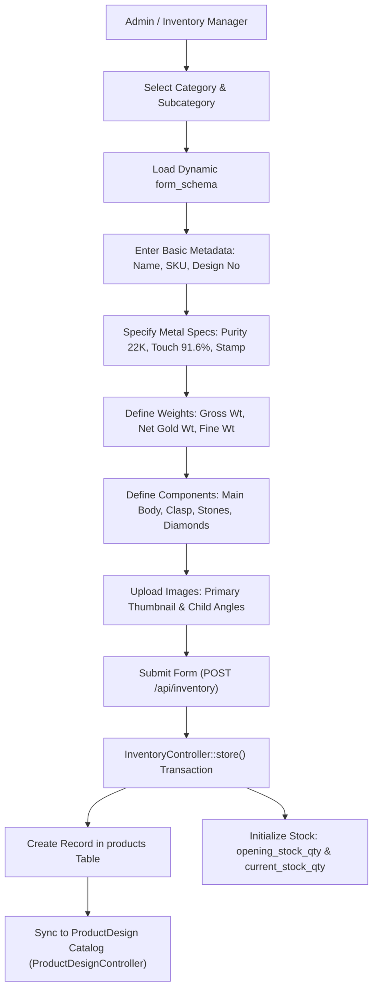
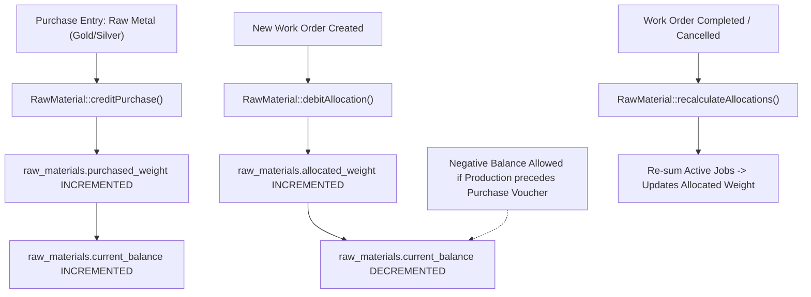
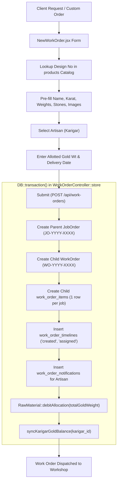
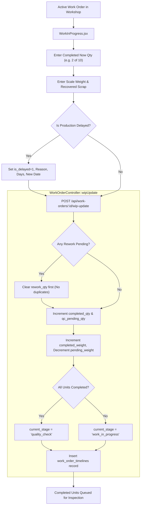
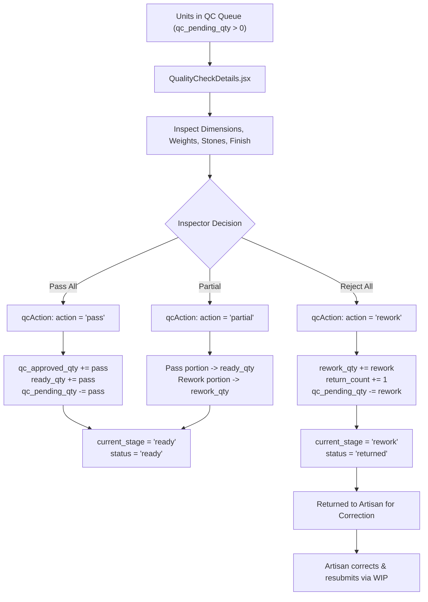
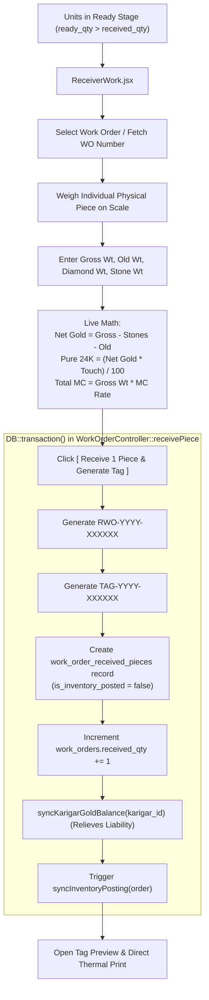
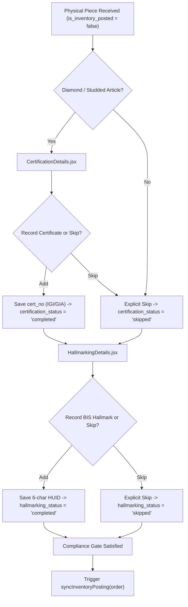
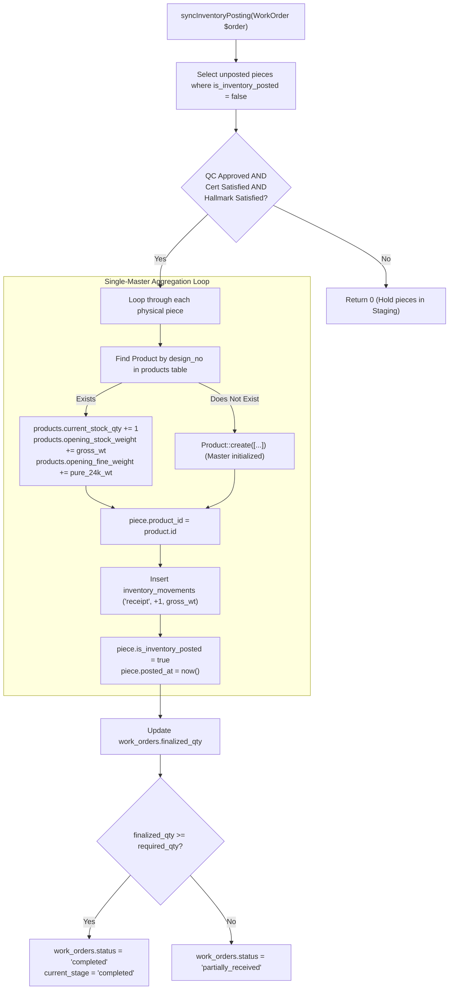
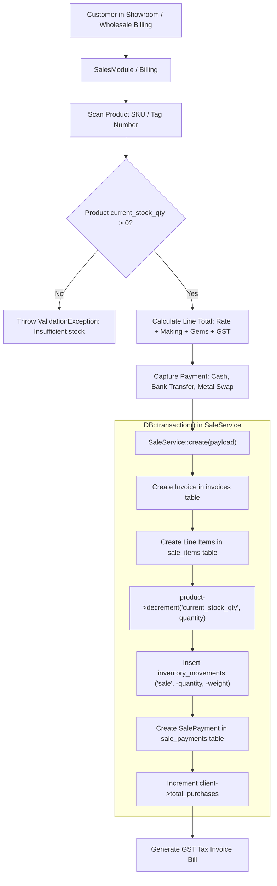
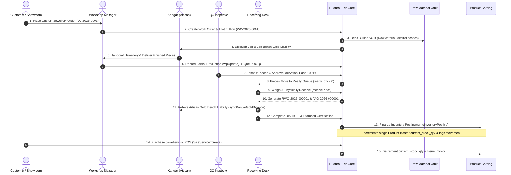

# 12. EXISTING WORKFLOW MERMAID DIAGRAMS

**System:** Rudhra Jewellers ERP  
**Scope:** Complete Visual Workflow Architecture & State Machine  
**Diagrams Included:** 10 Independent Mermaid Workflows covering every functional lifecycle.

---

## 1. Product Creation & Catalog Blueprint Workflow

---

## 2. Raw Material Vault & Bullion Inventory Workflow

---

## 3. Job Creation, Customer Contract & Allocation Workflow

---

## 4. Work in Progress (WIP) & Partial Production Workflow

---

## 5. Quality Check (QC), Tolerance & Rework Loop

---

## 6. Physical Piece Receiving & Barcode Tag Assignment

---

## 7. Certification & BIS Hallmarking Compliance Gate

---

## 8. Final Inventory Posting & Product Aggregation Workflow

---

## 9. Customer Sales (POS) & Stock Decrement Workflow

---

## 10. Master End-to-End Enterprise Lifecycle

