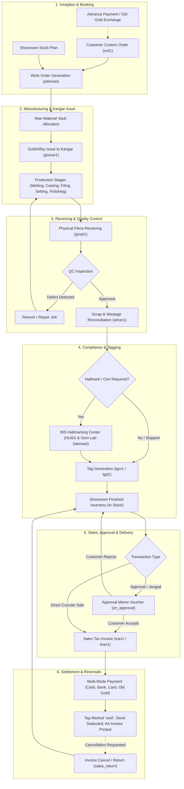
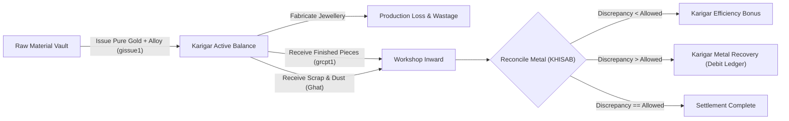
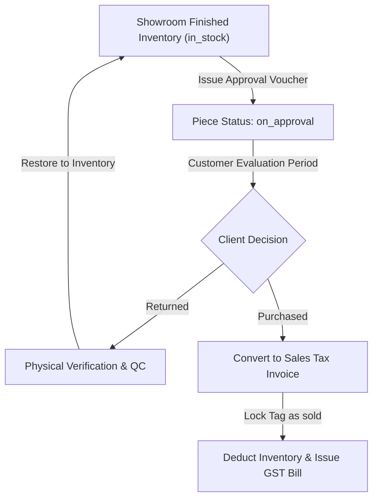
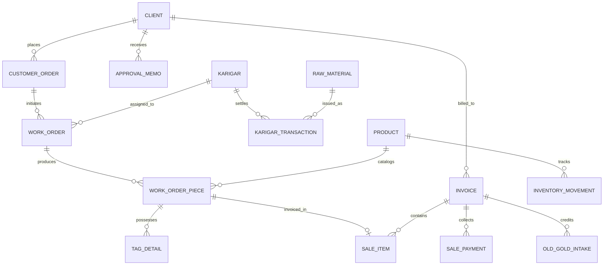

# Operational Workflows & Entity Relationships

**Project**: Rudra Jewellery ERP  
**Analysis Base**: Legacy Visual FoxPro Codebase & Modern Laravel/React Implementation

---

## 1. End-to-End Jewellery Operational Workflow

The following Mermaid diagram maps the complete path of business data from initial customer order/design through production, hallmarking, tagging, showroom inventory, point-of-sale invoicing, and reversal:

---

## 2. Karigar Metal Reconciliation Workflow

---

## 3. Approval / Jangad Memo Workflow

---

## 4. Entity Relationship Diagram (Core ERP Architecture)

