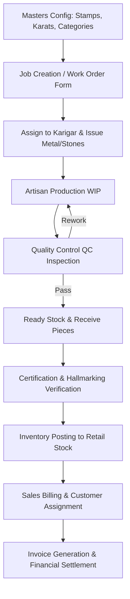

# Rudra Jewellery ERP — Master Technical Audit
## Document 03: End-to-End Business Workflows

This document traces the complete end-to-end operational workflows through source code, database tables, and state transitions.

---

### Workflow 1: Master Configuration to Production Lifecycle

#### Detailed Step-by-Step Trace:
1. **Job Creation**:
   - **Entry Point**: `NewWorkOrder.jsx` -> `POST /api/work-orders`
   - **Data Created**: `work_orders` record (status: `assigned`), `work_order_items`, `work_specifications`.
   - **Inventory Effect**: Debits raw material gold from `raw_materials` vault (`debitAllocation('gold', $weight)` in grams) and debits diamond carats (`debitAllocation('diamond', $carats)` in carats).
2. **Karigar Material Allocation**:
   - **Entry Point**: `MaterialAllocationModal.jsx` -> `POST /api/karigars/{id}/materials`
   - **Data Created**: `karigar_material_transactions` logging `transaction_type = 'issue'`, unit = `g` (for metals) or `ct` (for diamonds).
3. **Quality Control (QC)**:
   - **Entry Point**: `QualityCheckDetails.jsx` -> `POST /api/work-orders/{id}/qc`
   - **Transition**: `quality_status = 'approved'` or `'rework'`.
4. **Receiving & Piece Tagging**:
   - **Entry Point**: `ReceiverWork.jsx` -> `POST /api/work-orders/{id}/receive`
   - **Data Created**: Individual `work_order_received_pieces` records with distinct `tag_number`, `piece_number`, `gross_weight`, `net_gold_weight`, `design_no`.
5. **Certification & Hallmarking**:
   - **Entry Point**: `CertificationDetails.jsx` / `HallmarkingDetails.jsx`
   - **Transition**: `certification_status = 'certified'`, `hallmarking_status = 'hallmarked'`.
6. **Inventory Posting**:
   - **Entry Point**: `POST /api/work-orders/{id}/post-inventory`
   - **Data Created**: `inventory_movements` record, piece status transitions to `in_stock`.

---

### Workflow 2: Raw Material Purchase to Vault Stock
1. **Entry Point**: `PurchaseEntry.jsx` -> `POST /api/purchase-entries`
2. **Data Created**:
   - `purchase_entries` record with `purchase_type = 'raw_material'`.
   - Purity, Stamp, Touch %, Wastage %, Rate per gram/carat, Tax (CGST/SGST/IGST).
3. **Inventory Effect**:
   - `RawMaterial::creditStock($materialType, $weight, $carats, $pieces)`
   - Gold stock increases in grams; Diamond stock increases in carats under the designated stamp sieve grade.
   - `inventory_movements` created with `movement_type = 'purchase'`.

---

### Workflow 3: Client Gold Deposit (With vs. Without Fixed Rate)
1. **Entry Point**: `ClientMetalDepositModal.jsx` -> `POST /api/clients/{id}/metal-deposit`
2. **Business Rule**:
   - **Case A: Without Rate (Pure Gold Advance)**:
     - `convert_to_cash = false`, `deposit_rate = null`
     - Database increments `clients.gold_balance_grams` directly.
     - Cash balance is **NOT** credited. Client holds physical metal credit.
   - **Case B: With Rate Fixed**:
     - `convert_to_cash = true`, `deposit_rate = 7400`
     - Cash amount = `net_pure_weight * deposit_rate`.
     - Client's cash ledger balance (`current_balance`) is credited with financial rupees.

---

### Workflow 4: Sales, Old Gold Exchange & Payment Settlement
1. **Entry Point**: `SalesModule.jsx` -> `POST /api/sales`
2. **Data Created**:
   - `invoices` with `invoice_number`, `taxable_amount`, `gst_amount`, `total_amount`, `paid_amount`, `due_amount`, `status` (`paid`, `partial`, `unpaid`).
   - `sale_items` referencing `product_id` or piece `tag_number`.
   - `invoice_old_golds` (if customer exchanges old jewellery, deducting value from total).
   - `sale_payments` recording payment method (Cash, UPI, Card, Metal Credit).
3. **Inventory & Ledger Effect**:
   - Finished product stock decreased via `inventory_movements` (`movement_type = 'sale'`).
   - Client financial balance updated.
