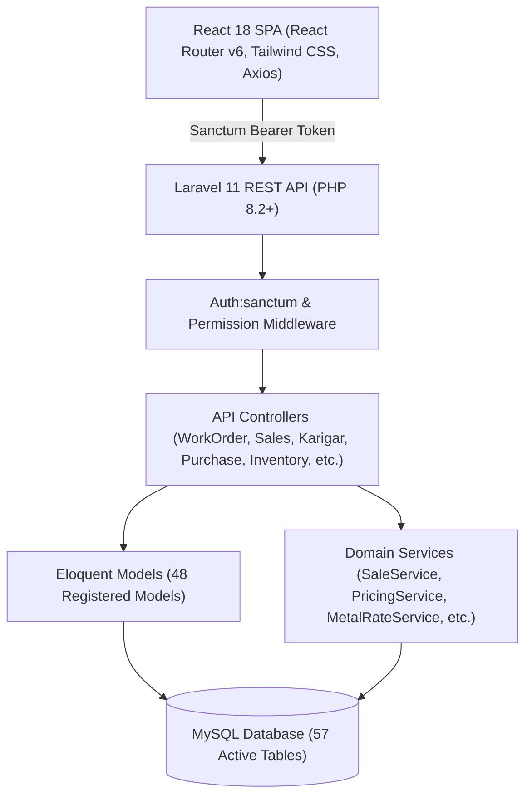

# Rudra Jewellery ERP — Complete System Flow, Module Dependency & Business Logic Audit

## Executive Summary

**Rudra Jewellery ERP** is an end-to-end, multi-tier enterprise jewellery manufacturing and retail management platform. The system coordinates the full lifecycle of custom jewellery production and wholesale/retail operations:
1. **Master Data & Pricing Configuration**: Multi-tier categorization (Category, Subcategory, Item, Product, ProductDesign), Karats, Stamps, Diamond Color/Clarity/Ranges, Units, Bank Accounts, Company Information, and Live Metal Rates.
2. **Raw Material & Supplier Operations**: Procurement of bullion (Gold, Silver) and gemstones (Diamonds, Colour Stones) from suppliers, handling both priced (monetary debt) and unpriced/unfixed (24K fine-gold metal debt) purchase contracts, with separate cash and physical metal supplier ledgers.
3. **Decoupled Job Creation & Production Lifecycle**: Creation of parent Job Orders (`JobOrder`) and child Work Orders (`WorkOrder`) with itemized quotas (`WorkOrderItem`). Material allocation is decoupled from order creation—drawing verified fine gold and parcel diamond carats from company vaults onto Karigar (artisan) workbench balances.
4. **WIP, Quality Control & Multi-Gate Receiving**: Karigars report finished pieces (`WorkOrderReceivedPiece`) which pass through an inspection workflow (QC Pass/Rework) into Ready status, optional downstream gates (Certification & Hallmarking HUID), and physical receiving.
5. **Inventory Posting & Tag Lifecycle**: Unique concurrency-safe Tag Numbers (`TAG-YYYY-XXXXXX`) and Receive Work Order Numbers (`RWO-YYYY-XXXXXX`) are generated. Upon physical receiving and gate clearance, child pieces are posted into sellable finished inventory (`Product` stock increment and `InventoryMovement` receipt log), strictly preventing parent-child double selling.
6. **Customer Pricing, Price-List Versioning & Sales**: Customer profiles with tiered discounts, active versioned price lists (`ClientPriceList`), diamond sieve/stamp pricing, making charges, Old Gold exchange intake (auto-deposited to scrap bullion), 3% GST calculation, and invoice finalization.
7. **Credit Sales, Payments & Financial Accounting**: Tracking invoice-level dues and customer-level outstanding balances, payment installment logging (`SalePayment`), automated Karigar making-charge payables (`KarigarPayment`), and Supplier settlements (`SupplierSettlement`).
8. **Statutory Reporting & Analytics**: Executive dashboards, real-time metal rates, statutory GST reports (GSTR-1 outward supplies, ITC-04 job work movement to/from artisans), periodic Karigar material/cash hisab, and supplier statement reconciliations.

---

## Technical Architecture & Stack

### Backend Architecture
- **Framework**: Laravel 11.x running on PHP 8.2.12.
- **Authentication**: Laravel Sanctum token-based authentication (`auth:sanctum`), user avatar uploads, session management, and granular permission checks (`PermissionRoute` / permission slug middleware).
- **Database**: Relational schema with 57 tables, supporting transactional consistency (`DB::transaction`), row-level locking (`lockForUpdate()`), soft deletes, and compound performance indexes.
- **Reporting & Calculations**: Dedicated domain service layer (`SaleService`, `PricingService`, `MetalRateService`, `NotificationService`, `WorkOrderMaterialRequirementService`, `WorkOrderGoldReconciliationService`, `ProductBulkUploadService`) enforcing 24K fine-gold conversions, diamond parcel weight calculations, and tax rules.

### Frontend Architecture
- **Framework**: React 18 with Vite bundling.
- **Routing**: Client-side React Router DOM v6 with dynamic route title updating (`PageTitleUpdater`), chunk-load retry mechanisms (`lazyWithRetry`), and role/permission guard components (`ProtectedRoute`, `PermissionRoute`, `GuestRoute`).
- **State & Context**: `AuthProvider` (token, user, permissions, role), `ToastProvider` (system notifications), responsive layout shells (`AppLayout`), and modal/drawer workflows.

---

## Audit Documentation Navigation

This comprehensive system audit is structured across ten dedicated, deeply technical documents:

| Document | File Path | Focus & Key Contents |
| :--- | :--- | :--- |
| **01. Audit Overview & Architecture** | [`README.md`](file:///c:/Users/Pugal%20Gokul/Documents/rudhra/docs/rudra-system-audit/README.md) | Executive summary, architectural stack, high-level workflow, and document index. |
| **02. Complete Module Inventory** | [`module-inventory.md`](file:///c:/Users/Pugal%20Gokul/Documents/rudhra/docs/rudra-system-audit/module-inventory.md) | Exhaustive catalogue of all 28 modules, web routes, React views, API endpoints, Eloquent models, and DB tables. |
| **03. End-to-End Business Flow** | [`end-to-end-business-flow.md`](file:///c:/Users/Pugal%20Gokul/Documents/rudhra/docs/rudra-system-audit/end-to-end-business-flow.md) | Detailed trace of business operations from master creation and procurement to production, inventory, sales, and payments. |
| **04. Database Relationship Map** | [`database-relationships.md`](file:///c:/Users/Pugal%20Gokul/Documents/rudhra/docs/rudra-system-audit/database-relationships.md) | Complete table grouping, primary/foreign keys, schema integrity, Mermaid ER diagram, and transaction maps. |
| **05. Cross-Module Dependency Matrices** | [`module-dependencies.md`](file:///c:/Users/Pugal%20Gokul/Documents/rudhra/docs/rudra-system-audit/module-dependencies.md) | Dependency matrix, stock movement matrix, financial impact matrix, and entity state transition matrix. |
| **06. Inventory & Karigar Reconciliation** | [`inventory-and-karigar-reconciliation.md`](file:///c:/Users/Pugal%20Gokul/Documents/rudhra/docs/rudra-system-audit/inventory-and-karigar-reconciliation.md) | Physical vs 24K fine gold, decoupled allocation, Karigar bench balance, wastage, scrap returns, and diamond carats. |
| **07. Sales, Client & Finance Flow** | [`sales-client-and-finance-flow.md`](file:///c:/Users/Pugal%20Gokul/Documents/rudhra/docs/rudra-system-audit/sales-client-and-finance-flow.md) | Customer pricing rules, price list versions, invoice lifecycle, tag deduplication, credit sales, Old Gold, and payments. |
| **08. Reports & Analytics Engine** | [`reports-and-dashboard.md`](file:///c:/Users/Pugal%20Gokul/Documents/rudhra/docs/rudra-system-audit/reports-and-dashboard.md) | Dashboard KPIs, metal rate engines, GSTR-1, ITC-04, periodic Karigar/Supplier monthly reports, and audit trails. |
| **09. Audit Findings & Risk Analysis** | [`audit-findings.md`](file:///c:/Users/Pugal%20Gokul/Documents/rudhra/docs/rudra-system-audit/audit-findings.md) | Evidence-backed findings classified by verified working, partial implementations, potential risks, and verified defects. |
| **10. Test Coverage & Verification** | [`test-coverage-and-verification.md`](file:///c:/Users/Pugal%20Gokul/Documents/rudhra/docs/rudra-system-audit/test-coverage-and-verification.md) | Existing test suite evaluation, inspection command logs, test coverage matrix, and remaining verification needs. |

---

## Scope & Non-Destructive Audit Certification

In strict accordance with the audit guidelines:
- **Zero Code Modification**: No application source code, controllers, models, migrations, seeders, routes, frontend views, or configuration files were edited, generated, or deleted.
- **Zero Database Modification**: No database migrations, rollbacks, seeders, destructive queries, or live business record updates were executed.
- **Safe Static & Read-Only Inspection**: All findings, code paths, formulas, schemas, and matrices documented herein are derived directly from static code analysis and safe inspection of the active codebase.
