# Rudra Jewellery ERP — Database Relationships, Schema Map & ER Diagram

## 1. Discovered Database Tables Grouped by Module

The database schema consists of **57 verified tables**, classified below across functional domain clusters:

| Module Group | Table Name | Migration Source | Primary Purpose |
| :--- | :--- | :--- | :--- |
| **System & Security** | `users` | `0001_01_01_000000_create_users_table.php` | User accounts, credentials, avatars, mobile, and assigned roles. |
| | `roles` | `2026_08_20_000003_create_roles_table.php` | System roles (`admin`, `manager`, `artisan`, `cashier`, `staff`). |
| | `permissions` | `2026_08_20_000004_create_permissions_table.php` | Granular permission slugs (`sales.create`, `karigars.view`, etc.). |
| | `personal_access_tokens` | `2026_08_21_000006_create_personal_access_tokens_table.php` | Laravel Sanctum API authentication tokens. |
| | `sessions`, `password_reset_tokens` | `0001_01_01_000000_create_users_table.php` | User session state and password reset security tokens. |
| | `cache`, `cache_locks` | `0001_01_01_000001_create_cache_table.php` | Application caching store and atomic mutex locks. |
| | `jobs`, `job_batches`, `failed_jobs` | `0001_01_01_000002_create_jobs_table.php` | Queue worker job dispatching and asynchronous batch execution. |
| **Masters & Config** | `categories` | `2026_08_22_000008_create_categories_table.php` | Top-level jewellery categories (Rings, Bangles, Necklaces, etc.). |
| | `subcategories` | `2026_08_22_000009_create_subcategories_table.php` | Sub-classifications linked to parent category via `category_id`. |
| | `items` | `2026_09_26_000001_create_items_table.php` | Canonical item types linked to categories and subcategories. |
| | `styles` | `2026_09_09_124848_create_styles_table.php` | Setting styles (Prong, Bezel, Pave, Channel, Tension, Flush). |
| | `gold_types` | `2026_09_11_000001_create_gold_types_table.php` | Gold alloy types (Yellow, White, Rose Gold, Dual Tone). |
| | `diamond_ranges` | `2026_09_11_000002_create_diamond_ranges_table.php` | Sieve size ranges, carats, pointer weights, and default rates. |
| | `diamond_colors` | `2026_09_28_000002_create_diamond_colors_and_clarities_tables.php` | Gemological color grades (D, E, F, G, H, I, J, Fancy). |
| | `diamond_clarities` | `2026_09_28_000002_create_diamond_colors_and_clarities_tables.php` | Gemological clarity grades (FL, IF, VVS1, VVS2, VS1, SI1, I1). |
| | `karats` | `2026_09_26_000001_create_karats_stamps_units_tables.php` | Standard purities (24K, 22K, 18K, 14K, 10K) and touch percentages. |
| | `stamps` | `2026_09_26_000001_create_karats_stamps_units_tables.php` | Hallmark signatures and diamond sieve stamps (e.g., `+11-14`, `916`). |
| | `units` | `2026_09_26_000001_create_karats_stamps_units_tables.php` | Measurement units (`g`, `ct`, `kg`, `pcs`, `oz`). |
| | `component_categories` | `2026_10_08_000001_create_component_categories_table.php` | Structural bill-of-material component categories. |
| | `operations` | `2026_10_10_000001_create_operations_table.php` | Manufacturing process steps (Casting, Filing, Setting, Polishing). |
| | `work_specifications` | `2026_09_12_070000_create_work_specifications_table.php` | Standard craftsmanship specifications and allowed tolerances. |
| | `bank_accounts` | `2026_09_22_000001_create_bank_accounts_table.php` | Corporate banking accounts and settlement channels. |
| | `company_infos` | `2026_09_22_000004_create_company_infos_table.php` | Corporate legal entity profiles, GSTIN, PAN, and header addresses. |
| | `memberships` | `2026_08_22_000013_create_memberships_table.php` | Client loyalty tiers (`Silver`, `Gold`, `Platinum`, `VIP`). |
| | `gold_rates` | `2026_10_16_000001_enhance_purchase_entries_and_create_gold_rates_table.php` | Daily bullion market rate table (24K, 22K, 18K, 14K, Silver). |
| **Clients & Pricing** | `clients` | `2026_08_22_000014_create_clients_table.php` | Customer profiles, codes, GSTIN, and opening balances. |
| | `client_price_lists` | `2026_08_27_000030_create_client_price_lists_table.php` | Client-specific versioned price contracts and override matrices. |
| **Suppliers & Purchases** | `suppliers` | `2026_08_26_000017_create_suppliers_table.php` | Vendor profiles with separate cash and 24K pure gold balances. |
| | `supplier_settlements` | `2026_10_23_000001_create_supplier_settlements_table.php` | Cash and physical bullion disbursement vouchers to suppliers. |
| | `purchase_entries` | `2026_08_27_000018_create_purchase_entries_table.php` | Procurement invoices for bullion, gemstones, or finished pieces. |
| **Raw Materials** | `raw_materials` | `2026_09_21_000001_create_raw_materials_table.php` | Vault inventory balances for gold, silver, diamonds, and stones. |
| | `material_opening_stocks` | `2026_10_12_000003_create_material_opening_stocks_table.php` | Auditable opening balance batches for raw material vaults. |
| | `material_types` | `2026_08_22_000007_create_material_types_table.php` | Classification master for metals and precious gems. |
| **Finished Inventory** | `products` | `2026_08_22_000010_create_products_table.php` | Finished catalogue jewellery designs, stock counts, and JSON specs. |
| | `product_designs` | `2026_09_10_060106_create_product_designs_table.php` | Design registry supporting client selection and catalog downloads. |
| | `inventory_movements` | `2026_09_16_000007_create_inventory_movements_table.php` | Double-entry stock ledger for all physical receipts, sales, and transfers. |
| **Manufacturing (Jobs)** | `job_orders` | `2026_10_05_000001_create_job_orders_and_update_work_orders.php` | Parent manufacturing batch order (`JO-YYYY-XXXX`). |
| | `work_orders` | `2026_09_15_120000_create_work_orders_and_timelines_tables.php` | Child manufacturing work orders (`WO-YYYY-XXXX`). |
| | `work_order_items` | `2026_10_08_100000_create_work_order_items_and_received_pieces_tables.php` | Line item design specifications and piece quotas within work orders. |
| | `work_order_timelines` | `2026_09_15_120000_create_work_orders_and_timelines_tables.php` | Stage history event log for work order milestones. |
| | `work_order_operations` | `2026_10_09_150000_create_work_order_operations_table.php` | Artisan WIP operational stage tracking logs. |
| | `work_order_received_pieces` | `2026_10_08_100000_create_work_order_items_and_received_pieces_tables.php` | Serialized individual child jewellery pieces (`TAG-YYYY-XXXXXX`). |
| | `work_order_notifications` | `2026_09_16_000002_create_work_order_notifications_table.php` | Topbar alert events and audit broadcast records. |
| **Karigar Operations** | `karigars` | `2026_09_12_060000_create_karigars_table.php` | Artisan directory with persistent 24K bench balance fields. |
| | `karigar_material_transactions` | `2026_10_12_000002_create_karigar_material_transactions_table.php` | Auditable material ledger for allocations, returns, wastage, and scrap. |
| | `karigar_payments` | `2026_10_23_100001_create_karigar_payments_and_enhance_material_transactions.php` | Financial making-charge ledger (auto-payables, advances, payments). |
| **Sales & Billing** | `invoices` | `2026_09_11_000003_create_invoices_table.php` | Sales invoices and billing records (`INV-YYYY-XXXXX`). |
| | `sale_items` | `2026_09_16_000005_create_sale_items_table.php` | Line items sold on invoices with snapshot rates and weights. |
| | `sale_payments` | `2026_09_16_000006_create_sale_payments_table.php` | Inward cash/bank/UPI payment installments on invoices. |
| | `invoice_old_golds` | `2026_10_22_000002_create_legacy_gap_modules_tables.php` | Old gold jewellery exchange intake items with melting loss. |
| **Supporting Modules** | `approval_memos` | `2026_10_22_000002_create_legacy_gap_modules_tables.php` | Approval memos (Jangad) issued to clients on inspection. |
| | `approval_memo_items` | `2026_10_22_000002_create_legacy_gap_modules_tables.php` | Serialized pieces out on approval with return/sale status. |
| | `repairs` | `2026_10_22_000002_create_legacy_gap_modules_tables.php` | Customer jewellery repair orders, added metals, and repair billing. |

---

## 2. Verified Entity-Relationship Diagram

```mermaid
erDiagram
    %% Core Masters
    CATEGORIES ||--o{ SUBCATEGORIES : "has"
    SUBCATEGORIES ||--o{ ITEMS : "classifies"
    CATEGORIES ||--o{ PRODUCTS : "groups"
    
    %% Clients & Pricing
    CLIENTS ||--o{ CLIENT_PRICE_LISTS : "has versions"
    CLIENTS ||--o{ JOB_ORDERS : "places"
    CLIENTS ||--o{ WORK_ORDERS : "requests"
    CLIENTS ||--o{ INVOICES : "bills"
    CLIENTS ||--o{ APPROVAL_MEMOS : "borrows"
    CLIENTS ||--o{ REPAIRS : "submits"
    
    %% Suppliers & Purchases
    SUPPLIERS ||--o{ PURCHASE_ENTRIES : "supplies"
    SUPPLIERS ||--o{ SUPPLIER_SETTLEMENTS : "settles"
    PURCHASE_ENTRIES ||--o| SUPPLIER_SETTLEMENTS : "links"
    PURCHASE_ENTRIES ||--o{ INVENTORY_MOVEMENTS : "logs"
    RAW_MATERIALS ||--o{ INVENTORY_MOVEMENTS : "tracks"
    PRODUCTS ||--o{ INVENTORY_MOVEMENTS : "tracks"

    %% Manufacturing Pipeline
    JOB_ORDERS ||--o{ WORK_ORDERS : "divides into"
    JOB_ORDERS ||--o{ WORK_ORDER_ITEMS : "contains"
    WORK_ORDERS ||--o{ WORK_ORDER_ITEMS : "contains"
    WORK_ORDERS ||--o{ WORK_ORDER_TIMELINES : "logs"
    WORK_ORDERS ||--o{ WORK_ORDER_OPERATIONS : "tracks"
    WORK_ORDERS ||--o{ WORK_ORDER_RECEIVED_PIECES : "yields"
    PRODUCTS ||--o{ WORK_ORDER_ITEMS : "targets"
    PRODUCTS ||--o{ WORK_ORDER_RECEIVED_PIECES : "mothers"

    %% Karigar Material & Finance
    KARIGARS ||--o{ WORK_ORDERS : "executes"
    KARIGARS ||--o{ KARIGAR_MATERIAL_TRANSACTIONS : "holds"
    KARIGARS ||--o{ KARIGAR_PAYMENTS : "earns"
    WORK_ORDERS ||--o{ KARIGAR_MATERIAL_TRANSACTIONS : "consumes"
    WORK_ORDERS ||--o{ KARIGAR_PAYMENTS : "charges"
    WORK_ORDER_RECEIVED_PIECES ||--o| KARIGAR_PAYMENTS : "triggers payable"

    %% Sales & Billing
    INVOICES ||--o{ SALE_ITEMS : "bills"
    INVOICES ||--o{ SALE_PAYMENTS : "collects"
    INVOICES ||--o{ INVOICE_OLD_GOLDS : "intakes"
    INVOICES ||--o{ INVENTORY_MOVEMENTS : "deducts"
    PRODUCTS ||--o{ SALE_ITEMS : "sells"
    WORK_ORDER_RECEIVED_PIECES ||--o| SALE_ITEMS : "identifies"
    INVOICES ||--o{ WORK_ORDER_RECEIVED_PIECES : "delivers"

    %% Approvals
    APPROVAL_MEMOS ||--o{ APPROVAL_MEMO_ITEMS : "includes"
    WORK_ORDER_RECEIVED_PIECES ||--o{ APPROVAL_MEMO_ITEMS : "lends"

    %% Schema Attributes Summary
    CLIENTS {
        int id PK
        string client_code
        string full_name
        decimal opening_balance
        string balance_type
    }
    SUPPLIERS {
        int id PK
        string name
        decimal current_balance "Cash Debt"
        decimal gold_balance_grams "24K Metal Debt"
    }
    RAW_MATERIALS {
        int id PK
        string material_type "gold|silver|diamond|stone"
        decimal current_balance
        int current_count
    }
    PRODUCTS {
        int id PK
        string product_code
        string design_no
        int current_stock_qty
        decimal opening_stock_weight
        json attributes
    }
    JOB_ORDERS {
        int id PK
        string job_order_number
        int client_id FK
        string status
    }
    WORK_ORDERS {
        int id PK
        string work_order_number
        int job_order_id FK
        int karigar_id FK
        decimal allotted_weight
        decimal completed_weight
        decimal pending_weight
        string status
    }
    WORK_ORDER_RECEIVED_PIECES {
        int id PK
        int work_order_id FK
        int product_id FK
        string tag_number UK
        string receive_order_number UK
        decimal gross_weight
        decimal net_gold_weight
        decimal pure_24k_weight
        string status "ready|received|in_stock|sold"
        boolean is_inventory_posted
    }
    INVOICES {
        int id PK
        string invoice_no UK
        int client_id FK
        decimal total_amount
        decimal paid_amount
        decimal due_amount
        string price_list_version
        string sale_status "draft|completed"
    }
    KARIGARS {
        int id PK
        string karigar_code UK
        string name
        decimal current_gold_balance_grams "Bench Balance"
    }
    KARIGAR_MATERIAL_TRANSACTIONS {
        int id PK
        int karigar_id FK
        int work_order_id FK
        string transaction_type "allocation|finished_received|unused_returned|approved_wastage"
        decimal fine_weight
        boolean is_reversed
    }
    KARIGAR_PAYMENTS {
        int id PK
        int karigar_id FK
        int received_piece_id FK
        string transaction_type "payable|advance|payment|adjustment"
        decimal amount
    }
```

---

## 3. Plain-English Analysis of Critical Relationships

### 1. JobOrder to WorkOrder to WorkOrderItem
- **Cardinality**: `JobOrder` (1) $\to$ `WorkOrder` (Many) $\to$ `WorkOrderItem` (Many).
- **Explanation**: A customer order or seasonal manufacturing batch begins as a parent `JobOrder` (`JO-YYYY-XXXX`). The parent is divided into child `WorkOrder` records assigned to specific artisans. Each work order contains one or more `WorkOrderItem` rows specifying target product designs, piece quotas, and diamond carat quotas.

### 2. WorkOrder to WorkOrderReceivedPiece to Product
- **Cardinality**: `WorkOrder` (1) $\to$ `WorkOrderReceivedPiece` (Many) $\to$ `Product` (1).
- **Explanation**: A work order for 10 rings produces 10 individual `WorkOrderReceivedPiece` records. Each piece receives a unique tag (`TAG-YYYY-XXXXXX`) and RWO number (`RWO-YYYY-XXXX`). Each piece points back to its catalogue parent (`Product`). When posted to inventory, the child piece increments the parent `Product.current_stock_qty` by 1 and embeds its tag in `Product.attributes['tags']`.

### 3. WorkOrder to Karigar to KarigarMaterialTransaction
- **Cardinality**: `Karigar` (1) $\to$ `KarigarMaterialTransaction` (Many) $\leftarrow$ `WorkOrder` (1).
- **Explanation**: Material issued to an artisan is tracked through `karigar_material_transactions`. These transactions link both the artisan and the work order, maintaining the artisan's cumulative bench balance across orders. Completing a work order does **not** erase bench balance; only explicit vault returns or finished receipts reduce it.

### 4. WorkOrderReceivedPiece to KarigarPayment
- **Cardinality**: `WorkOrderReceivedPiece` (1) $\to$ `KarigarPayment` (1).
- **Explanation**: When a finished jewellery piece is physically received via [`receivePiece`](file:///c:/Users/Pugal Gokul/Documents/rudhra/app/Http/Controllers/Api/WorkOrderController.php#L4101), the system automatically creates a `payable` in `karigar_payments` for the artisan's earned making charges. The `received_piece_id` foreign key prevents duplicate wage generation.

### 5. Invoice to SaleItem to WorkOrderReceivedPiece
- **Cardinality**: `Invoice` (1) $\to$ `SaleItem` (Many) $\to$ `WorkOrderReceivedPiece` (Many).
- **Explanation**: A sales invoice records the transaction. Line items (`SaleItem`) capture price snapshots. If a physical serialized piece was selected, the `WorkOrderReceivedPiece` is locked, its status updated to `sold`, and its `invoice_id` and `client_id` recorded. Generic parent products cannot be sold if unsold child pieces exist.

---

## 4. Transaction Dependency & Table Update Map

| Major Operation | API Trigger | Records Created | Records Updated | Inventory / Ledger Effect |
| :--- | :--- | :--- | :--- | :--- |
| **Raw Material Purchase** | `POST api/purchase-entries` | `purchase_entries`, `inventory_movements` | `raw_materials`, `suppliers` | Vault stock debited/credited; supplier cash/metal debt updated. |
| **Finished Jewellery Purchase** | `POST api/purchase-entries` | `purchase_entries`, `work_order_received_pieces` (tags), `inventory_movements` | `products`, `suppliers` | Product stock incremented; child tags created in `in_stock`. |
| **Work Order Creation** | `POST api/work-orders` | `job_orders`, `work_orders`, `work_order_items`, `work_order_timelines`, `work_order_notifications` | None | Quotas saved; **no vault stock deducted**. |
| **Material Allocation** | `POST api/karigars/{id}/allocate-materials` | `karigar_material_transactions` | `raw_materials` (if vault source), `work_orders`, `karigars` | Vault stock debited; Karigar bench balance and WO allotted weight incremented. |
| **WIP Update** | `POST api/work-orders/{id}/wip-update` | `work_order_received_pieces` (initial draft) | `work_orders`, `work_order_items` | Pieces queued for QC inspection. |
| **QC Pass** | `POST api/work-orders/{id}/qc-action` | None | `work_order_received_pieces`, `work_orders`, `work_order_items` | Piece marked `ready`; `ready_qty` incremented. |
| **Physical Piece Receive** | `POST api/work-orders/{id}/receive-piece` | `karigar_material_transactions` (finished receipt & returns), `karigar_payments` (auto-payable), `work_order_timelines` | `work_order_received_pieces`, `work_orders`, `raw_materials` (if scrap returned), `karigars` | RWO & Tag assigned; scrap returned to vault; Karigar making charge payable created; bench balance reduced. |
| **Inventory Posting** | `POST api/work-orders/{id}/finalize-inventory` | `inventory_movements` | `products`, `work_order_received_pieces`, `work_orders` | Piece marked `in_stock`; product stock count incremented; sellable in POS. |
| **Finalize Sale Invoice** | `POST api/sales/{id}/finalize` | `invoices`, `sale_items`, `sale_payments`, `invoice_old_golds`, `inventory_movements` | `products`, `work_order_received_pieces`, `clients`, `work_orders` (marked `delivered` if fully sold) | Piece marked `sold`; product stock decremented; client purchases incremented; old gold deposited to vault. |
| **Sale Cancellation** | `POST api/sales/{id}/cancel` | `inventory_movements` (return) | `invoices`, `products`, `work_order_received_pieces`, `work_orders` | Piece restored to `in_stock`; product stock restored; delivery status reset. |
| **Supplier Settlement** | `POST api/suppliers/{id}/settle` | `supplier_settlements`, `inventory_movements` (if vault gold disbursed) | `suppliers`, `purchase_entries`, `raw_materials` | Supplier cash or metal liability cleared; vault stock debited if physical gold delivered. |

---

## 5. Schema Integrity & Orphan-Record Risk Analysis

1. **Nullable Work Order Reference on Child Pieces**:
   - Migration `2026_10_24_155000_make_work_order_id_nullable_on_received_pieces.php` made `work_order_id` nullable on `work_order_received_pieces`.
   - **Reason**: Allows finished pieces created directly via Purchase Entries (direct supplier purchases) to share the same tag inventory table as manufacturing pieces.
   - **Risk**: Queries relying on `INNER JOIN work_orders` exclude direct-purchase inventory tags. All inventory queries must use `LEFT JOIN` or Eloquent optional relationships.
2. **JSON Attribute Redundancy in `products.attributes`**:
   - Component breakdowns, diamond sieves, gross weights, and tag lists are stored both in relational tables (`work_order_received_pieces`, `sale_items`) and inside `products.attributes` JSON.
   - **Mitigation**: Domain services enforce synchronization (`WorkOrderController@syncInventoryPosting` updates both relational fields and JSON attributes).
3. **Compound Indexes**:
   - Migration `2026_10_26_000001_add_performance_indexes_to_reporting_tables.php` added performance indexes across `invoices(invoice_date, sale_status)`, `karigar_material_transactions(karigar_id, transaction_type, transaction_date)`, and `work_order_received_pieces(product_id, status, is_inventory_posted)` to optimize live calculation queries.
