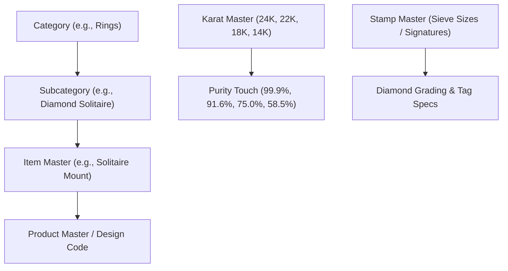
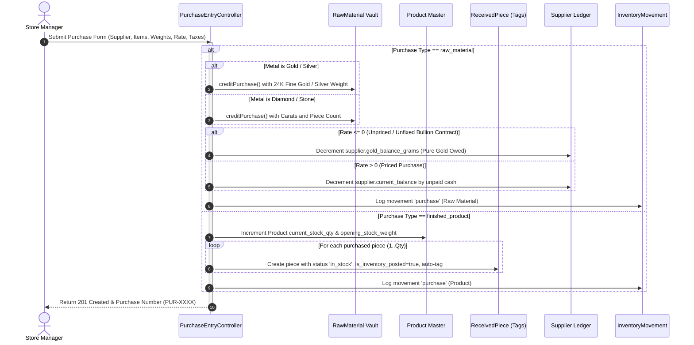
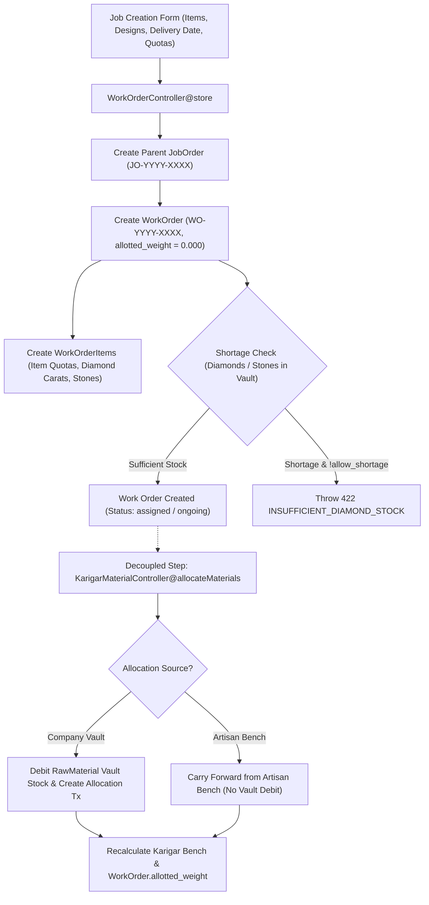
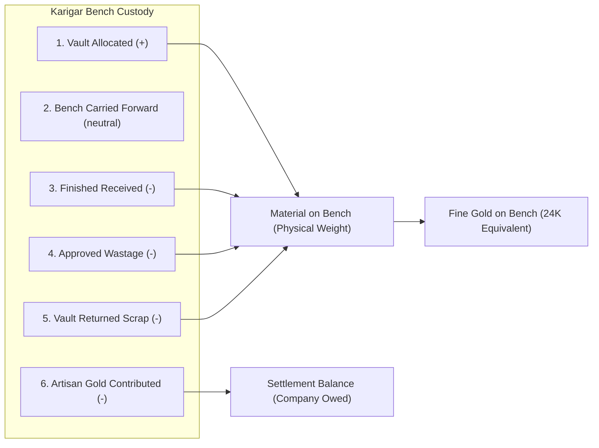
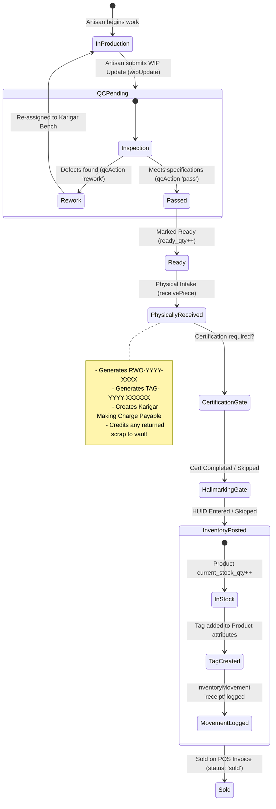
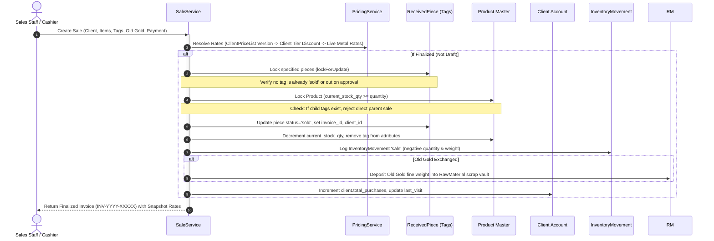

# Rudra Jewellery ERP — Complete End-to-End Business Workflow

## 1. High-Level Lifecycle Map

The Rudra Jewellery ERP business lifecycle connects procurement, manufacturing, inventory control, and retail POS accounting in a unified pipeline:

```mermaid
flowchart TD
    subgraph S1["1. Master Data & Configuration"]
        M1["Categories, Items & Units"]
        M2["Purities (Karats) & Stamps"]
        M3["Diamond Sieve Slabs & Colors"]
        M4["Suppliers, Karigars & Clients"]
        M5["Live Metal Rates & Price Lists"]
    end

    subgraph S2["2. Procurement & Vault Stock"]
        P1["Purchase Entry (Priced / Unpriced)"]
        P2{"Material Type?"}
        P3["Raw Material Vault (24K Fine Gold / Gemstones)"]
        P4["Finished Product Inventory"]
        P5["Supplier Ledger (Cash / Metal Owed)"]
    end

    subgraph S3["3. Job Order & Material Allocation"]
        J1["Job Order & Work Order Creation (Quotas Recorded)"]
        J2["Material Allocation Engine"]
        J3["Source: Company Vault (Debits RawMaterial)"]
        J4["Source: Karigar Bench (Carried Forward)"]
        J5["Artisan Bench Balance Updated"]
    end

    subgraph S4["4. WIP, Quality Check & Receiving"]
        W1["Work in Progress & Operation Tracking"]
        W2["Quality Control Inspection (Pass / Rework)"]
        W3["Ready Status"]
        W4["Physical Receiving Form (Gross/Net/Fine Gold)"]
        W5["Auto-Generate RWO & Tag Numbers"]
        W6["Downstream Gates (Certification & Hallmarking HUID)"]
    end

    subgraph S5["5. Inventory Posting & Sales"]
        I1["Final Inventory Posting (Product Stock Increment)"]
        I2["POS Billing & Sales Invoicing"]
        I3["Child Tag Selection (Prevents Double-Selling)"]
        I4["Client Price List & Tier Discount Resolution"]
        I5["Old Gold Exchange Intake"]
        I6["Inventory Deduction & Sold Tag Lock"]
    end

    subgraph S6["6. Finance, Ledgers & Statutory Compliance"]
        F1["Customer Invoice Payments & Outstanding Dues"]
        F2["Karigar Making Charge Ledger (Auto-Payables & Advances)"]
        F3["Supplier Settlements (Cash & Metal Disbursements)"]
        F4["Statutory Reporting (ITC-04 Job Work & GSTR-1 HSN 7113)"]
    end

    S1 --> S2
    S2 --> S3
    S3 --> S4
    S4 --> S5
    S5 --> S6
```



---

## 2. Detailed Lifecycle Stages

### Stage A: Setup & Master Data Architecture

The ERP requires a hierarchical foundation of master records before transactions can occur:



#### Mandatory Masters for Downstream Operations
1. **Raw Material Procurement**: Requires `suppliers`, `categories`, `stamps` (auto-created if missing), and `raw_materials` vault records.
2. **Work Order Creation**: Requires `job_orders` (parent), `categories`, `subcategories`, `karigars` (or worker allocation text), `stamps`, and client reference (`clients` or Walk-in fallback).
3. **Material Allocation**: Requires active `karigars`, `raw_materials` with positive balance in company vault (if issued from vault), and valid purity/touch definitions.
4. **Physical Piece Receiving**: Requires active Work Order, resolved `products` master (auto-created from design number if missing), and `gold_rates` for purchase valuation.
5. **Sales Invoicing**: Requires `clients` (or auto-provisioned Walk-in Customer `RJ-CL-1000`), active `products` with stock, or `work_order_received_pieces` with status `in_stock`.

---

### Stage B: Supplier Procurement & Inward Stock Flow

Bullion and gemstone purchasing is managed via [`PurchaseEntryController.php`](file:///c:/Users/Pugal%20Gokul/Documents/rudhra/app/Http/Controllers/Api/PurchaseEntryController.php):



#### Bullion Valuation & 24K Pure Conversion Rules
In [`PurchaseEntryController.php`](file:///c:/Users/Pugal%20Gokul/Documents/rudhra/app/Http/Controllers/Api/PurchaseEntryController.php#L340-L360):
- **Gross Weight**: Physical scale weight.
- **Less Weight**: Weight of packaging, base metal alloys, or stones.
- **Net Weight**: Gross Weight minus Less Weight.
- **Fine Gold Equivalent**:
  $$\text{Fine Weight (24K)} = \text{Net Weight} \times \frac{\text{Touch} + \text{Wastage \%}}{100}$$
  For 22K (916 Hallmarked), Touch = 91.60%. If net weight is 100.000g, Fine Gold = 91.600g.
- **Unfixed vs Fixed Bullion Contracts**:
  - If `rate <= 0`: The bullion is unpriced. No monetary payable is created; instead, the physical 24K pure fine weight is credited to `supplier.gold_balance_grams` (as a negative balance representing metal owed).
  - If `rate > 0`: The contract is fixed in cash. Unpaid amount is credited to `supplier.current_balance` (as a negative balance representing cash owed).

---

### Stage C: Work Order Creation & Decoupled Allocation

Work Orders represent manufacturing orders issued to artisans:



#### Decoupled Material Allocation Business Rule
1. **Creation does not deduct vault stock**: Creating a Work Order saves product requirements, design numbers, and planned gold/diamond weights, but `work_orders.allotted_weight` remains `0.000g`.
2. **Individual Material Allocation**: When materials are physically handed to the artisan, [`KarigarMaterialController@allocateMaterials`](file:///c:/Users/Pugal%20Gokul/Documents/rudhra/app/Http/Controllers/Api/KarigarMaterialController.php#L800-L960) validates available vault balances, creates `karigar_material_transactions` of type `allocation`, debits `raw_materials` (if sourced from vault), and increments `work_orders.allotted_weight` and `work_orders.pending_weight`.
3. **Shortage Protection**: Prevents creating jobs if vault diamonds or stones are insufficient, unless the manager explicitly sets `allow_shortage = true`.

---

### Stage D: Karigar Workbench Balances & Scrap Reconciliation

The ERP enforces a strict distinction between physical weight and 24K pure gold across all artisan transactions:



#### Verified Calculation Rules ([`KarigarMaterialController.php`](file:///c:/Users/Pugal%20Gokul/Documents/rudhra/app/Http/Controllers/Api/KarigarMaterialController.php#L1420-L1472))
- **Vault Issued**:
  $$\text{Vault Issued} = \sum_{\text{source} \neq \text{'bench'}} (\text{fine\_weight})$$
- **Production Consumed**:
  $$\text{Production Consumed} = \sum_{\text{type} \in [\text{'finished\_received'}, \text{'production\_consumption'}]} (\text{fine\_weight})$$
- **Approved Wastage**:
  $$\text{Approved Wastage} = \sum_{\text{type} = \text{'approved\_wastage'}} (\text{fine\_weight})$$
- **Vault Returned Scrap**:
  $$\text{Vault Returned} = \sum_{\text{type} \in [\text{'unused\_returned'}, \text{'vault\_return'}, \text{'physical\_return'}]} (\text{fine\_weight})$$
- **Persistent Bench Balance**:
  $$\text{Bench Balance} = \max(0, \text{Vault Issued} - \text{Production Consumed} - \text{Approved Wastage} - \text{Vault Returned} \pm \text{Adjustments})$$
- **Settlement Balance**:
  $$\text{Settlement Balance} = \text{Bench Balance} - \text{Artisan Gold Contributed}$$

> [!IMPORTANT]
> Completing a Work Order does **not** automatically return unused gold to the company vault. Unused material remains on the artisan's workbench balance until an explicit `unused_returned` or `vault_return` transaction is logged, physically returning scrap metal to the company vault and crediting `raw_materials`.

---

### Stage E: WIP, Quality Control & Multi-Gate Receiving

The journey of an individual piece through inspection, compliance gates, and inventory posting:



#### Multi-Gate Receiving & Inventory Posting Rules ([`WorkOrderController.php`](file:///c:/Users/Pugal%20Gokul/Documents/rudhra/app/Http/Controllers/Api/WorkOrderController.php#L2793-L3050))
1. **Piece Receipt**: [`receivePiece`](file:///c:/Users/Pugal%20Gokul/Documents/rudhra/app/Http/Controllers/Api/WorkOrderController.php#L3459) captures verified gross weight, diamond sieves, and purity. It computes net gold weight using:
   $$\text{Net Gold Weight} = \text{Gross Weight} - (\text{Diamond Carats} \times 0.2) - (\text{Colour Stone Carats} \times 0.2) - \text{Old Weight}$$
2. **Automatic Karigar Payable**: Creates a record in `karigar_payments` of type `payable` for earned making charges, keyed idempotently by `received_piece_id`.
3. **Scrap Vault Return**: If `returned_gold_weight > 0`, it logs a `karigar_material_transactions` of type `unused_returned` and executes `RawMaterial::creditAllocation('gold', $fineWeight)`, physically restocking the vault.
4. **Downstream Gate Verification**:
   - `certification_status`: Must be `completed`, `skipped`, or `not_required`.
   - `hallmarking_status`: Must be `completed` (with HUID), `skipped`, or `not_required`.
5. **Inventory Posting Idempotency**: [`syncInventoryPosting`](file:///c:/Users/Pugal%20Gokul/Documents/rudhra/app/Http/Controllers/Api/WorkOrderController.php#L2793) verifies that `alreadyMoved` does not exist in `inventory_movements` for that tag. It increments `products.current_stock_qty` by 1, appends the tag to `products.attributes['tags']`, sets `work_order_received_pieces.is_inventory_posted = true`, and sets `status = 'in_stock'`.

---

### Stage F: Sales Invoicing, Client Pricing & Stock Deduction

Retail and wholesale sales execution via [`SaleService.php`](file:///c:/Users/Pugal%20Gokul/Documents/rudhra/app/Services/SaleService.php):



#### Prevention of Parent-Child Double Selling ([`SaleService.php`](file:///c:/Users/Pugal%20Gokul/Documents/rudhra/app/Services/SaleService.php#L168-L180))
If an inventory product design has unsold physical child pieces (`WorkOrderReceivedPiece`) in inventory, the system **blocks** cashiers from selling the generic parent product:
```php
$unsoldChildPiecesCount = WorkOrderReceivedPiece::where('product_id', $product->id)
    ->whereNotIn('status', ['sold', 'cancelled', 'returned'])
    ->whereNull('invoice_id')
    ->count();

if ($unsoldChildPiecesCount > 0 && $matchedPiecesForLine->isEmpty()) {
    throw ValidationException::withMessages([
        'items' => "Product '{$product->name}' has {$unsoldChildPiecesCount} physical piece tag(s) in inventory. Please select an individual child piece/tag rather than selling the parent product directly to prevent double-selling."
    ]);
}
```

#### Customer Pricing & Price List Version Snapshot
1. **Tiered Discounts**: Automatically applies discounts based on customer membership (`PLATINUM/VIP` = 5%, `GOLD` = 3%, `SILVER` = 0%) unless overridden by customer-specific discount percentage.
2. **Version Freezing**: The active price list version (`client_price_lists.version`) is saved into `invoices.price_list_version` and `sale_items.price_list_version`. Subsequent price changes to the customer price list never alter past finalized sales.
3. **Old Gold Intake**: Valued by Net Weight $\times$ Touch $\times$ Rate. Fine gold weight is immediately deposited into `raw_materials` vault via `RawMaterial::quickStockAdd()`.

---

### Stage G: Credit Sales, Payments & Balances

Invoice and payment handling:
1. **Invoice Balance**:
   $$\text{Due Amount} = \text{Total Amount} - \text{Paid Amount} - \text{Old Gold Credit}$$
2. **Payment Recording**: [`SaleService@recordPayment`](file:///c:/Users/Pugal%20Gokul/Documents/rudhra/app/Services/SaleService.php#L615) logs payment records (`SalePayment`), updates invoice `paid_amount` and `due_amount`, and updates invoice status (`paid`, `partial`, or `pending`).
3. **Cancellation & Reversals**: Cancelling a sale invoice via [`SaleService@cancel`](file:///c:/Users/Pugal%20Gokul/Documents/rudhra/app/Services/SaleService.php#L716) restores all physical pieces to `in_stock`, clears `invoice_id`, increments product `current_stock_qty`, restores tags, logs an `InventoryMovement` of type `'return'`, and if the sale had delivered a customer work order, resets `work_orders.status` from `delivered` back to `completed`.
