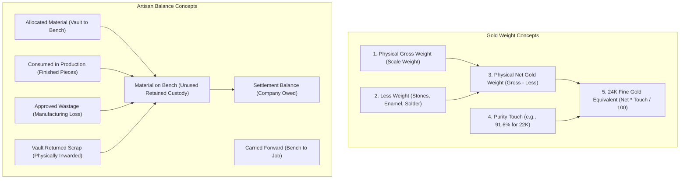

# Rudra Jewellery ERP — Inventory & Karigar Reconciliation Engine

## 1. Overview of the Reconciliation Architecture

In high-value precious jewellery manufacturing, physical scale weight and pure gold content diverge significantly due to alloying (e.g. 22K 91.6% gold, 18K 75.0% gold, 14K 58.5% gold) and non-metallic gemstones (diamonds, pearls, colour stones). 

Rudra Jewellery ERP manages this complexity through a dual-accounting architecture:
1. **Physical Material Scale Ledger**: Tracks gross weight, stone deductions, and physical custody across company vaults, artisan workbenches, and finished product trays.
2. **24K Pure Fine-Gold Accounting Ledger**: Converts all alloyed metal issuances, finished receipts, approved wastages, and scrap returns into equivalent 24K pure fine gold ($99.9\%$ purity) to maintain mathematical parity across jobs.

---

## 2. Core Material Concepts & Distinctions



### Definitions & Code Implementation

1. **Physical Gross Weight (`gross_weight`)**: Total scale weight of an item or lot, including precious metal, alloys, diamonds, and colour stones.
2. **Physical Net Gold Weight (`net_gold_weight` / `net_weight`)**:
   $$\text{Net Gold Weight} = \text{Gross Weight} - (\text{Diamond Carats} \times 0.2) - (\text{Colour Stone Carats} \times 0.2) - \text{Old Weight}$$
   *(Note: 1 carat = 0.200 grams)*. Verified in [`WorkOrderController.php:3557`](file:///c:/Users/Pugal%20Gokul/Documents/rudhra/app/Http/Controllers/Api/WorkOrderController.php#L3557).
3. **24K Fine-Gold Equivalent (`fine_weight` / `pure_24k_weight`)**:
   $$\text{Fine Weight (24K)} = \text{Net Gold Weight} \times \frac{\text{Touch Percent}}{100}$$
   Verified in [`GoldConversionHelper::convertTo24kPureWeight()`](file:///c:/Users/Pugal%20Gokul/Documents/rudhra/app/Helpers/GoldConversionHelper.php).
4. **Allocated Material (`allotted_weight` / `tx: allocation`)**: Metal and gemstones issued to an artisan for a job. Sourced either from Company Vault (`source = 'vault'`) or artisan bench (`source = 'bench'`).
5. **Material Consumed in Production (`completed_weight` / `tx: finished_received`)**: The verified net metal weight physically embedded in completed jewellery pieces delivered to the store.
6. **Approved Manufacturing Wastage (`wastage_weight` / `tx: approved_wastage`)**: Allowed gold loss during filing, polishing, casting, and setting. Deducted from the artisan's physical liability once approved by the QC inspector.
7. **Unused Material Retained on Bench (`current_gold_balance_grams`)**: Unconsumed metal remaining on the artisan's workbench after completing a job. **The system does not treat completing an order as an automatic return to vault.**
8. **Material Physically Returned to Vault (`returned_weight` / `tx: unused_returned`)**: Physical scrap, casting runners, or filings weighed and returned to company custody, crediting vault raw materials.
9. **Material Outstanding with Karigar (`pending_weight` / `settlement_balance_grams`)**: Net 24K pure gold that the artisan is legally accountable to return to the company.

---

## 3. Persistent Ledger vs Derived Balances

A critical architectural finding of this audit is that **the application persists an auditable double-entry transaction ledger** while maintaining synchronized summary columns for high-speed indexing:

- **Authoritative Source of Truth**: The `karigar_material_transactions` table records every atomic movement:
  - `allocation`: Issuance to artisan.
  - `finished_received`: Receipt of finished jewellery piece.
  - `approved_wastage`: Approved manufacturing loss.
  - `unused_returned`: Physical return of scrap to company vault.
  - `karigar_contribution`: Artisan's own gold supplied for production.
  - `adjustment`: Manager audit correction.
  - `settlement`: Metal balance buyout or conversion.
- **Synchronized Cache Columns**: The `karigars` table maintains cached summary fields (`current_gold_balance_grams`, `karigar_gold_balance_grams`, `settlement_balance_grams`). These fields are continuously resynchronized via [`KarigarMaterialController@syncKarigarBalances`](file:///c:/Users/Pugal%20Gokul/Documents/rudhra/app/Http/Controllers/Api/KarigarMaterialController.php#L1420).

---

## 4. Verified Calculation Rules & Formulas

### 1. Karigar Gold Bench Balance Formula
Implemented in [`KarigarMaterialController.php:1428-1460`](file:///c:/Users/Pugal%20Gokul/Documents/rudhra/app/Http/Controllers/Api/KarigarMaterialController.php#L1428-L1460):

$$\begin{aligned}
\text{Vault Issued} &= \sum_{\substack{\text{type} \in [\text{alloc}, \text{add\_alloc}, \text{issue}] \\ \text{source} \neq \text{'bench'}}} (\text{fine\_weight}) \\
\text{Production Consumed} &= \sum_{\text{type} \in [\text{finished\_received}, \text{consumption}]} (\text{fine\_weight}) \\
\text{Approved Wastage} &= \sum_{\text{type} = \text{'approved\_wastage'}} (\text{fine\_weight}) \\
\text{Vault Returned} &= \sum_{\text{type} \in [\text{unused\_returned}, \text{vault\_return}, \text{scrap}]} (\text{fine\_weight}) \\
\text{Bench Balance} &= \max\left(0, \text{Vault Issued} - \text{Production Consumed} - \text{Approved Wastage} - \text{Vault Returned} \pm \text{Adjustments}\right)
\end{aligned}$$

### 2. Work Order Pending Weight Formula
Implemented in [`WorkOrderController.php:3919-3925`](file:///c:/Users/Pugal%20Gokul/Documents/rudhra/app/Http/Controllers/Api/WorkOrderController.php#L3919-L3925):

$$\text{WO Pending Wt} = \max\left(0, (\text{Allotted Wt} + \text{Addl Allotted Wt}) - \text{Completed Wt} - \text{Wastage Wt} - \text{Returned Wt}\right)$$

### 3. Diamond Bench Balance Formula
Implemented in [`KarigarMaterialController.php:138-156`](file:///c:/Users/Pugal%20Gokul/Documents/rudhra/app/Http/Controllers/Api/KarigarMaterialController.php#L138-L156):

$$\begin{aligned}
\text{Diamond Carats on Bench} &= \sum \text{Allocated Carats} - \left(\sum \text{Consumed Carats} + \sum \text{Returned Carats}\right) \\
\text{Diamond Pieces on Bench} &= \sum \text{Allocated Pieces} - \left(\sum \text{Consumed Pieces} + \sum \text{Returned Pieces}\right)
\end{aligned}$$

---

## 5. Gemstone, Diamond Sieve & Stamp Reconciliation

In jewellery manufacturing, diamond parcel tracking involves sieve-based sorting:
1. **Multi-Sieve Component Breakdown**: A single Work Order or Purchase Entry can allocate multiple sieve sizes (e.g. `+11-14`, `+6.5-11`, `+2-6`, `Star`, `Melle`).
2. **Authoritative Stamp Registration**: The system checks [`stamps`](file:///c:/Users/Pugal%20Gokul/Documents/rudhra/app/Models/Stamp.php). If a supplier or piece brings a new sieve stamp not in the database, [`PurchaseEntryController:248-263`](file:///c:/Users/Pugal%20Gokul/Documents/rudhra/app/Http/Controllers/Api/PurchaseEntryController.php#L248-L263) auto-registers the stamp.
3. **Parcel Weight vs Piece Count Tolerance**:
   - In parcel buying, carat weight is the authoritative financial measure.
   - If diamond carat weight in the vault covers the required weight, piece count shortages are allowed to draw from parcels without throwing artificial blocking errors ([`WorkOrderController:579-586`](file:///c:/Users/Pugal%20Gokul/Documents/rudhra/app/Http/Controllers/Api/WorkOrderController.php#L579-L586)).

---

## 6. Prohibited Material Allocations

In strict adherence to the Rudra Jewellery ERP business rules:
- **Prohibited Loose Stone Allocation**: Karigars procure loose colour stones independently. In [`WorkOrderController.php:328-336`](file:///c:/Users/Pugal%20Gokul/Documents/rudhra/app/Http/Controllers/Api/WorkOrderController.php#L328-L336):
```php
if ($request->filled('material_type')) {
    $mat = strtolower($request->input('material_type'));
    if (str_contains($mat, 'colour_stone') || str_contains($mat, 'loose_stone')) {
        throw ValidationException::withMessages([
            'material_type' => ['Loose Stone Allocation Prohibited: Karigars procure loose colour stones independently. Metals and certified Diamonds can be allocated to work orders.']
        ]);
    }
}
```
Metals (Gold, Silver, Platinum) and certified Diamonds can be allocated from the company vault, while loose colour stones are verified upon physical receiving and reimbursed or accounted for in the finished piece valuation.

---

## 7. Reversals & Inconsistency Audit

1. **Reversal Isolation**: Reversing a material transaction (`POST api/karigars/{id}/reverse-material-transaction/{txId}`) marks `is_reversed = true` on the original transaction and creates an offsetting opposite transaction. It recalculates raw material stock and synchronizes the artisan's bench balance atomically inside a database transaction.
2. **Idempotent Wastage**: Wastage on a work order is guarded by `alreadyHasWastageTx` ([`WorkOrderController:4067`](file:///c:/Users/Pugal%20Gokul/Documents/rudhra/app/Http/Controllers/Api/WorkOrderController.php#L4067)) to prevent multi-piece receiving runs from repeatedly recording the full work order wastage allowance on every individual piece intake.
