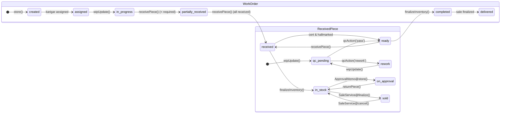

# Rudra Jewellery ERP — Module Dependency, Stock Movement & Financial Matrices

## 1. Cross-Module Dependency Matrix

This matrix documents data passed, triggering events, responsible controllers/services, affected database records, and verification status across all system modules:

| Source Module | Destination Module | Data Passed | Triggering Action | API / Service Responsible | Database Records Affected | Verified Status |
| :--- | :--- | :--- | :--- | :--- | :--- | :--- |
| **Masters (Purities & Stamps)** | **Purchase Entries** | Karat touch %, stamp names, diamond sieve sizes | User creates purchase | `PurchaseEntryController@store` | Reads `karats`, `stamps`; auto-creates new stamps in `stamps` | Verified Working |
| **Suppliers** | **Purchase Entries** | `supplier_id`, credit days, existing balance | Purchase voucher submitted | `PurchaseEntryController@store` | Reads `suppliers`; updates `suppliers.current_balance` / `gold_balance_grams` | Verified Working |
| **Purchase Entries** | **Raw Material Vault** | Bullion weight (24K fine conversion), diamond carats, stone units | Purchase voucher saved | `RawMaterial::creditPurchase()` | Increments `raw_materials.purchased_weight`, `current_balance`, creates `inventory_movements` | Verified Working |
| **Purchase Entries** | **Finished Inventory** | Product code, design number, attributes, piece tags | Finished piece purchase saved | `PurchaseEntryController@store` | Increments `products.current_stock_qty`, creates `work_order_received_pieces` (tags) | Verified Working |
| **Clients** | **Work Orders** | `client_id`, customer name, delivery dates | Job creation submitted | `WorkOrderController@store` | Saves `work_orders.client_id`, `job_orders.client_id` | Verified Working |
| **Products & Designs** | **Work Orders** | Design number, expected gold weight, diamond quotas | Adding job rows in WO | `WorkOrderController@store` | Sets `work_orders.product_id`, creates `work_order_items` | Verified Working |
| **Raw Material Vault** | **Karigar Allocation** | Available vault weight/carats | Manager issues materials to artisan | `KarigarMaterialController@allocateMaterials` | Debits `raw_materials.current_balance`, creates `karigar_material_transactions` | Verified Working |
| **Karigar Bench** | **Work Orders** | Gross weight, purity, 24K fine equivalent | Allocating materials to job | `KarigarMaterialController@allocateMaterials` | Updates `work_orders.allotted_weight`, `pending_weight`, `karigars.current_gold_balance_grams` | Verified Working |
| **WIP Tracking** | **Quality Control** | Completed piece count, actual weights, wastage | Artisan submits piece | `WorkOrderController@wipUpdate` | Creates/updates `work_order_received_pieces` with `status: qc_pending` | Verified Working |
| **Quality Control** | **Ready Status** | Inspection approval, verified weights, remarks | QC inspector clicks Pass | `WorkOrderController@qcAction` | Updates `work_order_received_pieces.status = 'ready'`, increments `work_orders.ready_qty` | Verified Working |
| **Ready Pieces** | **Receive Work Order** | Piece selection, gross weight, diamond sieves, scrap | Receiver physically weighs piece | `WorkOrderController@receivePiece` | Updates `work_order_received_pieces.received_at`, creates `karigar_material_transactions`, generates Tag & RWO | Verified Working |
| **Receive Work Order** | **Karigar Ledgers** | Making charges earned, scrap gold returned | Piece intake confirmed | `WorkOrderController@receivePiece` | Creates `karigar_payments` (`payable`), credits scrap to `raw_materials`, updates bench balance | Verified Working |
| **Receive Work Order** | **Certification / Hallmarking** | Tag number, design code, gross/net weight | Compliance dispatch | `WorkOrderController@updateCertification`, `updateHallmarking` | Updates `certificate_no`, `huid`, gate statuses in `work_order_received_pieces` | Verified Working |
| **Certification / Hallmarking** | **Inventory Posting** | Gate completion verification | Auto/manual finalize | `WorkOrderController@syncInventoryPosting` | Sets `is_inventory_posted = true`, increments `products.current_stock_qty`, logs `inventory_movements` | Verified Working |
| **Finished Inventory** | **Sales Billing (POS)** | Serialized piece tags, gross/net weights, diamond sieves | Cashier scans/selects piece | `SalesController@availablePieces`, `SaleService@create` | Locks `work_order_received_pieces`, checks `current_stock_qty` | Verified Working |
| **Client Price Lists** | **Sales Billing (POS)** | Active version rates, tier discounts, making charges | Invoicing item resolution | `PricingService::calculateItemPrice` | Snapshot saved to `invoices.price_list_version` and `sale_items` | Verified Working |
| **Sales Invoicing** | **Finished Inventory** | Sold pieces and product quantities | Finalizing sale invoice | `SaleService@finalize` | Decrements `products.current_stock_qty`, updates piece `status = 'sold'`, logs `inventory_movements` | Verified Working |
| **Sales Invoicing** | **Raw Material Vault** | Old Gold exchange weight and touch | Exchanging scrap gold in bill | `RawMaterial::quickStockAdd()` | Credits 24K fine gold to `raw_materials` scrap vault | Verified Working |
| **Sales Invoicing** | **Work Orders** | Delivered pieces check | Invoice finalization | `SaleService@create` / `finalize` | If all pieces of WO sold, updates `work_orders.status = 'delivered'` | Verified Working |
| **Sales Invoicing** | **Customer Ledger** | Invoice total, payment made, due balance | Invoice finalization / payments | `SaleService@recordPayment` | Increments `client.total_purchases`, records `sale_payments`, updates `invoices.due_amount` | Verified Working |
| **Sales Invoicing** | **Statutory GST (GSTR-1)** | Taxable value, CGST (1.5%), SGST (1.5%), GSTIN | Reporting period query | `ReportController@gstr1Summary` | Reads finalized `invoices`, separates B2B vs B2C | Verified Working |
| **Karigar Allocations / Receives** | **Statutory GST (ITC-04)** | Material dispatched vs finished pieces received | Quarterly tax query | `ReportController@itc04Report` | Reads `karigar_material_transactions` (Table 1) and `work_order_received_pieces` (Table 2) | Verified Working |
| **Supplier Settlements** | **Suppliers** | Cash paid or physical gold delivered | Settle voucher recorded | `SupplierController@settle` | Clears `suppliers.current_balance` (cash) or `gold_balance_grams` (metal debt) | Verified Working |

---

## 2. Stock Movement Matrix

This matrix tracks the physical and logical movement of materials, basis of calculation, expected effects, and duplicate-posting protections:

| Operation | Material / Product Type | Source Location | Destination Location | Quantity / Weight Basis | Expected Stock Effect | Code Path | Duplicate-Posting Protection |
| :--- | :--- | :--- | :--- | :--- | :--- | :--- | :--- |
| **Raw Material Purchase** | Gold / Silver Bullion | Supplier | Company Vault | 24K Pure Fine Weight (g) | Vault `current_balance` increases | `RawMaterial::creditPurchase()` | Unique `purchase_no` validation in `PurchaseEntryController` |
| **Raw Material Purchase** | Diamonds | Supplier | Company Vault | Carats (ct) and Piece Count | Vault `current_balance` & `current_count` increase | `RawMaterial::creditPurchase()` | Unique `purchase_no` validation |
| **Finished Jewellery Purchase** | Finished Products | Supplier | Finished Inventory & Tag Store | Qty (pcs) & Gross Weight (g) | Product `current_stock_qty` increases; tags created as `in_stock` | `PurchaseEntryController@store` | Unique `purchase_no` & auto-generated unique tags |
| **Work Order Creation** | Metals & Gemstones | N/A | Manufacturing Quota | Planned Gross Wt (g) & Carats | **No vault stock change** (Quotas recorded only) | `WorkOrderController@store` | Unique `job_order_number` & `work_order_number` |
| **Material Allocation (Vault)** | Gold (by Karat) | Company Vault | Karigar Bench | 24K Fine Equivalent (g) | Vault decreases; Karigar bench increases | `KarigarMaterialController@allocateMaterials` | Row-level locking on `raw_materials` + DB transaction |
| **Material Allocation (Bench)** | Gold / Diamonds | Karigar Bench | Work Order Quota | Net Weight (g) / Carats (ct) | Vault unchanged; Bench allocated | `KarigarMaterialController@allocateMaterials` | Source flag (`bench`) bypasses `RawMaterial::debitAllocation` |
| **Piece Physical Receiving** | Finished Piece | Karigar Bench | Store Receiving Vault | Gross Wt (g) & Net Gold (g) | Piece created; Bench consumption recorded | `WorkOrderController@receivePiece` | Unique `receive_order_number` & `tag_number` |
| **Scrap Gold Return** | Scrap / Unused Gold | Karigar Bench | Company Vault | 24K Pure Fine Weight (g) | Karigar bench decreases; Vault increases | `WorkOrderController@receivePiece` | Idempotent transaction linked to `work_order_id` & piece number |
| **Inventory Posting** | Finished Piece Tag | Receiving Vault | Sellable Finished Stock | 1 Piece & Gross Weight (g) | Product `current_stock_qty` + 1; Tag added to attributes | `WorkOrderController@syncInventoryPosting` | Checks `alreadyMoved` in `inventory_movements` for tag |
| **Sales POS Invoicing** | Finished Piece Tag | Finished Stock | Customer | 1 Piece & Gross Weight (g) | Product `current_stock_qty` - 1; Tag marked `sold` | `SaleService@finalize` | Atomic piece locking (`lockForUpdate`) checking `status !== 'sold'` |
| **Sales Cancellation** | Finished Piece Tag | Customer | Finished Stock | 1 Piece & Gross Weight (g) | Product `current_stock_qty` + 1; Tag restored to `in_stock` | `SaleService@cancel` | Guarded by `sale_status !== 'cancelled'` check |
| **Old Gold Exchange** | Scrap Jewellery | Customer | Company Scrap Vault | Net Wt $\times$ Touch = 24K Fine Gold | Raw material gold vault increases | `RawMaterial::quickStockAdd()` | Processed only upon invoice finalization |
| **Supplier Gold Settlement** | 24K Pure Bullion | Company Vault | Supplier | 24K Pure Fine Weight (g) | Vault stock decreases; Supplier metal debt decreases | `SupplierController@settle` | Logged in `inventory_movements` (`supplier_settlement`) |

---

## 3. Financial Impact Matrix

This matrix governs accounts receivable, accounts payable, making charge wages, advances, and ledger impacts:

| Operation | Entity Impacted | Transaction Reference | Debit / Credit Effect | Outstanding Balance Effect | Calculation Source |
| :--- | :--- | :--- | :--- | :--- | :--- |
| **Priced Purchase Entry** | Supplier | `PUR-XXXX` | Credit: Unpaid purchase amount | Increases cash payable owed to supplier | `total_amount - paid_amount` in `PurchaseEntryController` |
| **Unpriced Purchase Entry** | Supplier | `PUR-XXXX` | Credit: 24K Pure Fine Gold grams | Increases physical metal debt owed to supplier | `fine_weight` credited to `supplier.gold_balance_grams` |
| **Supplier Cash Payment** | Supplier | Settlement Voucher | Debit: Cash disbursed | Decreases cash payable (or increases cash advance held) | Settle amount added to `supplier.current_balance` |
| **Supplier Gold Settlement** | Supplier | Settlement Voucher | Debit: 24K Pure Gold delivered | Decreases metal debt (or increases metal advance held) | Settle fine weight added to `supplier.gold_balance_grams` |
| **Piece Physical Receiving** | Karigar | `MC-WO-{id}-PC-{pieceId}` | Credit: Earned Making Charge | Increases payable owed to artisan | `net_gold_weight * making_charge_per_gram` in `WorkOrderController` |
| **Karigar Cash Payment** | Karigar | Payment Voucher | Debit: Cash paid to artisan | Decreases payable owed to artisan | Amount subtracted from net balance in `KarigarPayment` |
| **Karigar Advance Payment** | Karigar | Advance Voucher | Debit: Advance cash paid | Creates/increases excess advance against future wages | Amount tracked under `transaction_type: advance` |
| **Sales POS Invoicing** | Client | `INV-YYYY-XXXXX` | Debit: Total billed invoice value | Increases customer debt (accounts receivable) | Subtotal + GST (3%) - Discount in `SaleService` |
| **Old Gold Exchange Credit** | Client | `INV-YYYY-XXXXX` | Credit: Scrap gold value | Offsets invoice grand total | Net Wt $\times$ Touch $\times$ Rate in `InvoiceOldGold` |
| **Customer Payment Received** | Client | Payment Receipt | Credit: Cash/UPI/Bank collected | Decreases customer invoice due & total outstanding | Amount recorded in `sale_payments`, decrements `invoices.due_amount` |
| **Sales Cancellation** | Client | `INV-YYYY-XXXXX` | Reversal: Invoices voided | Removes invoice due and reverses client total purchases | `SaleService@cancel` reverses `client.total_purchases` |

---

## 4. Entity State Transition Matrix

This matrix tracks the verified lifecycle states, triggering events, endpoints, and validation conditions:

### Entity: Work Order (`work_orders`)
| Previous Status | Trigger Event | New Status | Responsible Endpoint | Validation Conditions | Downstream Effect |
| :--- | :--- | :--- | :--- | :--- | :--- |
| `[None]` | Work order creation | `created` / `assigned` | `POST api/work-orders` | Valid design, dates, and non-prohibited materials | Job order initialized; notifications dispatched |
| `created` | Artisan assigned | `assigned` | `POST api/work-orders/{id}/karigar-update` | Valid `karigar_id` | Artisan notification dispatched |
| `assigned` | Artisan reports progress | `in_progress` | `POST api/work-orders/{id}/wip-update` | Completed now $\le$ remaining required + rework | QC queue incremented |
| `in_progress` | QC Pass / Rework | `quality_check` / `rework` | `POST api/work-orders/{id}/qc-action` | Piece belongs to WO; valid inspection quantities | Ready queue or rework queue updated |
| `in_progress` / `ready` | Piece physically received | `partially_received` | `POST api/work-orders/{id}/receive-piece` | Received qty < Required qty | RWO & Tag assigned; Karigar payable logged |
| `partially_received` | Last piece received | `received` | `POST api/work-orders/{id}/receive-piece` | Received qty $\ge$ Required qty | Advances to Certification or Hallmarking gate |
| `received` | Gates cleared | `ready` | `POST api/work-orders/{id}/move-to-ready` | Cert & Hallmarking completed or skipped | Ready for inventory posting |
| `ready` | Inventory posted | `completed` | `POST api/work-orders/{id}/finalize-inventory` | Finalized qty $\ge$ Required qty | Product stock incremented; sellable in POS |
| `completed` | All pieces sold on POS | `delivered` | `POST api/sales/{id}/finalize` | All received pieces marked `sold` | Parent work order closed; customer notified |
| `delivered` | Sales invoice cancelled | `completed` | `POST api/sales/{id}/cancel` | Invoice cancellation confirmed | Pieces restored to stock; WO reopened |

---

### Entity: Individual Serialized Piece (`work_order_received_pieces`)
| Previous Status | Trigger Event | New Status | Responsible Endpoint | Validation Conditions | Downstream Effect |
| :--- | :--- | :--- | :--- | :--- | :--- |
| `[None]` | WIP submission | `qc_pending` | `POST api/work-orders/{id}/wip-update` | Completed qty $> 0$ | Piece record created with piece number |
| `qc_pending` | QC Rejection | `rework` | `POST api/work-orders/{id}/qc-action` | Defect reason provided | Returned to artisan bench |
| `qc_pending` / `rework` | QC Approval | `ready` | `POST api/work-orders/{id}/qc-action` | Inspected quantity matches piece | Ready for physical receiving |
| `ready` | Physical intake | `received` | `POST api/work-orders/{id}/receive-piece` | Gross wt $> 0$; net gold wt $> 0$ | Tag number generated; Karigar payable created |
| `received` | Inventory sync | `in_stock` | `POST api/work-orders/{id}/finalize-inventory` | Gates passed/skipped; tag not already moved | Added to Product stock; sellable |
| `in_stock` | Lent on approval | `on_approval` | `POST api/approvals` | Piece in stock and not sold | Blocked from retail POS sale |
| `on_approval` | Client returns piece | `in_stock` | `POST api/approvals/{id}/return-piece/{itemId}` | Item status is pending | Restored to sellable stock |
| `in_stock` | Finalized POS sale | `sold` | `POST api/sales/{id}/finalize` | Piece is `in_stock` and not sold | Locked with `invoice_id` & `client_id` |
| `sold` | Sale cancelled | `in_stock` | `POST api/sales/{id}/cancel` | Invoice is active | Restored to sellable stock; `invoice_id` cleared |
