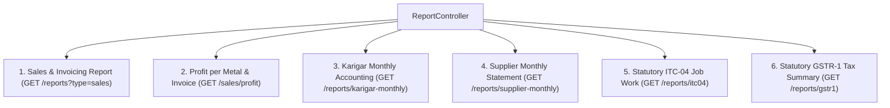
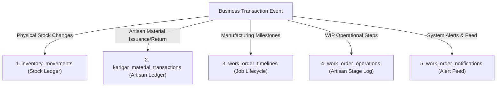

# Rudra Jewellery ERP — Reports, Dashboards & Audit Trails Engine

## 1. Overview

The Rudra Jewellery ERP analytics engine provides real-time business intelligence across sales, production, inventory, vendor payables, artisan ledgers, and statutory taxation compliance. Calculations are computed directly from transactional tables to guarantee reconciliation with operational modules.

---

## 2. Dashboard Widgets & KPI Derivation

### 1. Executive Metric Cards ([`DashboardController@index`](file:///c:/Users/Pugal%20Gokul/Documents/rudhra/app/Http/Controllers/Api/DashboardController.php))

| Dashboard Metric Card | Source Query / Calculation Logic | Source Tables | Filters Applied | Live vs Stored Summary |
| :--- | :--- | :--- | :--- | :--- |
| **Total Invoices / Sales Count** | `Invoice::count()` within selected period | `invoices` | `sale_status NOT IN ('cancelled', 'void', 'returned')` | Live Query |
| **Total Sales Revenue** | `Invoice::sum('total_amount')` | `invoices` | Excludes cancelled/void invoices | Live Query |
| **Paid Amount (Cash Collected)** | `Invoice::sum('paid_amount')` | `invoices` | Excludes cancelled/void invoices | Live Query |
| **Accounts Receivable (Due Amount)** | `Invoice::sum('due_amount')` | `invoices` | Excludes cancelled/void invoices; `due_amount > 0` | Live Query |
| **Net Gross Profit** | `Invoice::sum('profit_amount')` or $\sum (\text{Revenue} - \text{Cost})$ | `invoices` | Excludes cancelled/void invoices | Live Query |
| **Active Customer Directory** | `Client::where('status', 'active')->count()` | `clients` | `deleted_at IS NULL` | Live Query |
| **Bullion Vault Stock (24K Gold)** | `RawMaterial::where('material_type', 'gold')->value('current_balance')` | `raw_materials` | Material type = `gold` | Stored Synchronized Balance |
| **Diamond Vault Stock (Carats)** | `RawMaterial::where('material_type', 'diamond')->value('current_balance')` | `raw_materials` | Material type = `diamond` | Stored Synchronized Balance |
| **Active Work Orders in WIP** | `WorkOrder::whereNotIn('status', ['completed', 'cancelled', 'delivered'])->count()` | `work_orders` | Active production stages | Live Query |
| **Delayed Work Orders** | `WorkOrder::where('delivery_date', '<', today)->whereNotIn('status', ['completed', 'delivered'])->count()` | `work_orders` | Overdue delivery date | Live Query |
| **Artisan Material on Bench** | `Karigar::sum('current_gold_balance_grams')` | `karigars` | Active artisans | Stored Synchronized Bench Balance |
| **Artisan Cash Wages Payable** | Calculated from `karigar_payments` earned minus payments | `karigar_payments` | Transaction types `payable`, `payment`, `advance` | Live Derived Sum |

---

### 2. Metal Rates Engine & Historical Averages ([`DashboardController@metalRates`](file:///c:/Users/Pugal%20Gokul/Documents/rudhra/app/Http/Controllers/Api/DashboardController.php))
- **Live Rate Storage**: Daily rates are retrieved from [`gold_rates`](file:///c:/Users/Pugal%20Gokul/Documents/rudhra/app/Models/GoldRate.php) for `rate_date = today`. If no record exists, the system creates today's baseline from yesterday's closing rate or falls back to system defaults:
  - 24K Pure Gold: `₹7,500.00 / g`
  - 22K (916 Hallmarked): `₹6,875.00 / g`
  - 18K Gold: `₹5,625.00 / g`
  - 14K Gold: `₹4,375.00 / g`
  - Silver: `₹92.00 / g`
- **Period Gold Averages**: Computes rolling 7-day, 30-day, quarterly, and annual arithmetic averages for 22K and 24K gold to support trend analytics.

---

## 3. Dedicated Business Reports Catalog ([`ReportController.php`](file:///c:/Users/Pugal%20Gokul/Documents/rudhra/app/Http/Controllers/Api/ReportController.php))

### 1. Sales & Invoicing Report (`GET api/reports?type=sales`)
- **Source**: `invoices` joined with `clients` and `sale_items`.
- **Filters**: Period presets (`today`, `week`, `month`, `quarter`, `year`, `all`) or custom `start_date` / `end_date`.
- **Exclusion Rules**: Invoices marked `sale_status = 'cancelled'` or `status = 'void'` are excluded from revenue totals.
- **Growth Calculations**: Automatically compares active period revenue against the exact previous elapsed period to compute percentage growth (`+14.2% vs Prev Month`).

### 2. Profit per Metal Report (`GET api/reports/profit-per-metal`)
- **Source**: `sale_items` joined with `invoices` and `products`.
- **Grouping**: Groups sales by precious metal category (24K Gold, 22K Gold, 18K Gold, 14K Gold, Silver, Platinum, Diamonds).
- **Formulas**:
  $$\begin{aligned}
  \text{Revenue} &= \sum (\text{sale\_items.line\_total}) \\
  \text{Cost} &= \sum (\text{sale\_items.cost\_amount}) \\
  \text{Gross Profit} &= \text{Revenue} - \text{Cost} \\
  \text{Profit Margin \%} &= \frac{\text{Gross Profit}}{\text{Revenue}} \times 100
  \end{aligned}$$

### 3. Karigar Monthly Accounting Report (`GET api/reports/karigar-monthly`)
- **Source**: Evaluates `karigar_material_transactions` and `karigar_payments`.
- **Reconciliation Scope**: Runs in a batch query across all artisans, calculating:
  1. **Opening Balances**: Net gold fine weight, diamond carats/pieces, and cash wage balance prior to the start date.
  2. **Period Additions**: Material allocated and making charges earned during the month.
  3. **Period Deductions**: Finished jewellery pieces delivered, approved wastages, scrap returned, and wage disbursements paid.
  4. **Closing Balances**: Exact material remaining on bench and net wage payable/advance at month-end.

### 4. Supplier Monthly Statement (`GET api/reports/supplier-monthly`)
- **Source**: Evaluates `purchase_entries` and `supplier_settlements`.
- **Dual Reconciliation**: Separately reconciles:
  1. **Monetary Account**: Opening cash debt + Priced purchases + Taxes - Cash payments = Closing cash liability.
  2. **Metal Bullion Account**: Opening 24K pure gold debt + Unpriced bullion weight received - Physical metal settlements delivered = Closing 24K pure gold liability.

### 5. Statutory ITC-04 Job Work Report (`GET api/reports/itc04`)
- **Compliance Mandate**: Quarterly statutory GST return mandated under Section 143 of the CGST Act for goods sent to and received back from job workers (Karigars).
- **Table 1 (Goods Dispatched to Job Worker)**:
  - Source: `karigar_material_transactions` where `transaction_type = 'issue'` or `'allocation'` with `source = 'vault'`.
  - Captures: Dispatch voucher, date, Karigar name/PAN, material description (Gold Bullion, Diamonds), gross weight, touch %, unit cost, and estimated dispatch value.
- **Table 2 (Goods Received Back from Job Worker)**:
  - Source: `work_order_received_pieces` received during the quarter.
  - Captures: Tag number, RWO date, Work Order reference, Karigar name, finished article description (HSN 7113), gross weight, net gold weight, diamond weight, HUID, and making charges billed.

### 6. Statutory GSTR-1 Outward Supplies Summary (`GET api/reports/gstr1`)
- **Compliance Mandate**: Monthly outward supplies return under HSN code `7113` (Articles of jewellery and parts thereof, of precious metal).
- **B2B vs B2C Segregation**:
  - **B2B Supplies**: Invoices where `clients.gst_number` is present. Displays Customer GSTIN, Place of Supply, Taxable Value, CGST (1.5%), SGST (1.5%), and Invoice Grand Total.
  - **B2C Supplies**: Retail sales where customer is unregistered or walk-in. Grouped by tax rate (3.0% GST).

---

## 4. Comprehensive Audit Log & Transaction History Map

Rudra Jewellery ERP records operational audit events across five dedicated audit log mechanisms:

| Audit Table | Triggering Events Recorded | Captured Data Fields | Immutability / Retention |
| :--- | :--- | :--- | :--- |
| **`inventory_movements`** | Finished piece receipts, sales, purchase receipts, old gold intake, stock adjustments, supplier settlements | `product_id`, `raw_material_id`, `invoice_id`, `purchase_entry_id`, `movement_type`, `quantity`, `weight`, `unit_cost`, `notes`, `created_by` | Immutable ledger. Reversals log new compensating entries of type `'return'` or `'adjustment'`. |
| **`karigar_material_transactions`** | Allocations, finished receipts, approved wastages, scrap returns, artisan contributions, metal buyouts | `karigar_id`, `work_order_id`, `transaction_type`, `material_type`, `purity`, `touch`, `pieces`, `gross_weight`, `net_weight`, `fine_weight`, `signed_change`, `reason`, `is_reversed`, `action_by_name` | Immutable historical rows. Reversals mark `is_reversed = true` and create a matching reversal voucher. |
| **`work_order_timelines`** | Creation, artisan assignment, physical piece intake, QC pass/rework, certification, hallmarking, delivery | `work_order_id`, `stage`, `stage_label`, `completed_weight_at_step`, `pending_weight_at_step`, `status`, `notes`, `user_id`, `action_by_name`, `created_at` | Append-only event stream recording operator name and timestamp. |
| **`work_order_operations`** | Artisan WIP stage execution (Casting, Filing, Setting, Polishing) | `work_order_id`, `operation_id`, `stage`, `assigned_weight`, `completed_weight`, `loss_weight`, `artisan_name`, `started_at`, `completed_at` | Tracks production routing and operation cycle times. |
| **`work_order_notifications`** | Work order created, piece received, inventory posted, purchase entry created | `type`, `title`, `message`, `data` (JSON payload with IDs, amounts, tag numbers), `is_read`, `read_at`, `created_by` | User-facing notification feed supporting dismissal and mark-all-read. |
