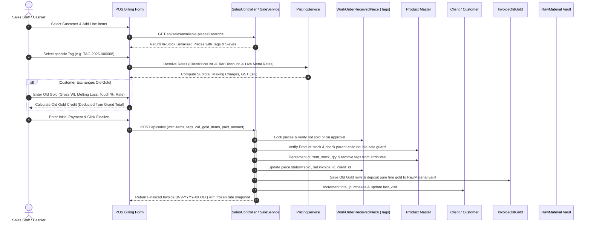
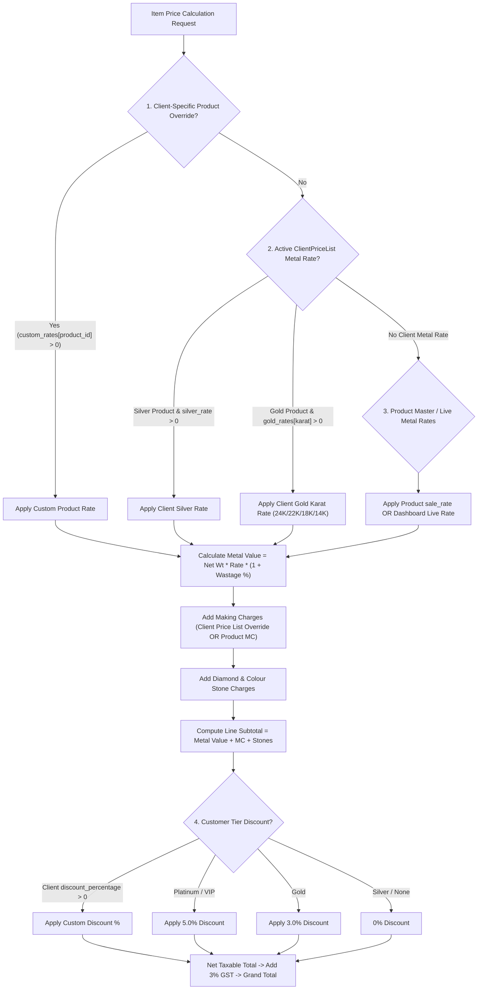

# Rudra Jewellery ERP — Sales, Client Pricing & Financial Accounting Flow

## 1. Overview of the Sales & Invoicing Architecture

The Sales and Billing module connects finished inventory, customer pricing contracts, and point-of-sale (POS) invoicing. It prevents stock discrepancies through serialized piece-tag selection, freezes customer price-list versions on every sale, supports Old Gold exchange intake directly into scrap vaults, and maintains accounts receivable ledgers.



---

## 2. Customer Pricing & Price-List Version Resolution

Pricing is deterministically resolved through [`PricingService::calculateItemPrice()`](file:///c:/Users/Pugal%20Gokul/Documents/rudhra/app/Services/PricingService.php):



### Price-List Version Freezing
- When an invoice is created, the system fetches the customer's active price list version (`client_price_lists.version`) and writes it to `invoices.price_list_version` and `sale_items.price_list_version` ([`SaleService.php:265-274`](file:///c:/Users/Pugal%20Gokul/Documents/rudhra/app/Services/SaleService.php#L265-L274)).
- **Historical Immutability**: If a customer's price list is updated tomorrow to Version `02`, past invoices continue to display Version `01` and retain their historical line rates, ensuring accounting immutability.

---

## 3. Parent vs. Child Tag Selection & Double-Sale Prevention

A core feature of the ERP is strict separation between parent catalogue designs and child serialized inventory tags:

1. **Physical Tag Selection**: Cashiers select specific tags via `GET api/sales/available-pieces`. The API filters out sold pieces (`status != 'sold'`) and pieces currently out on approval memo (`status != 'on_approval'`).
2. **Double-Sale Guard**: In [`SaleService.php:168-180`](file:///c:/Users/Pugal%20Gokul/Documents/rudhra/app/Services/SaleService.php#L168-L180), if a product design has physical child piece tags in inventory, the system **blocks** selling the generic parent product:
```php
$unsoldChildPiecesCount = WorkOrderReceivedPiece::where('product_id', $product->id)
    ->whereNotIn('status', ['sold', 'cancelled', 'returned'])
    ->whereNull('invoice_id')
    ->count();

if ($unsoldChildPiecesCount > 0 && $matchedPiecesForLine->isEmpty()) {
    throw ValidationException::withMessages([
        'items' => "Product '{$product->name}' has {$unsoldChildPiecesCount} physical piece tag(s) in inventory. Please select an individual child piece/tag rather than selling the parent product directly to prevent double-selling."
    ]);
}
```
3. **Atomic Concurrency Lock**: In finalizing sales, all selected pieces are locked using `lockForUpdate()`. If two cashiers scan the same barcode tag simultaneously, the first transaction commits and marks the piece `status = 'sold'`, and the second transaction immediately aborts with:
   `Physical piece with Tag 'TAG-YYYY-XXXXXX' has already been sold or invoiced.`

---

## 4. Old Gold Exchange Intake Flow

When a retail customer trades in old gold jewellery towards a new purchase:
1. **Intake Breakdown**: The cashier captures `item_description`, `gross_weight`, `melting_loss`, `purity_touch`, and agreed `rate_per_gram`.
2. **Net & Fine Weight Calculation**:
   $$\begin{aligned}
   \text{Net Weight} &= \text{Gross Weight} - \text{Melting Loss} \\
   \text{Fine Weight (24K)} &= \text{Net Weight} \times \frac{\text{Purity Touch}}{100} \\
   \text{Old Gold Credit} &= \text{Fine Weight} \times \text{Rate Per Gram}
   \end{aligned}$$
3. **Invoice Offset**: Total Old Gold credit is stored in `invoices.old_gold_amount` and offsets customer payable:
   $$\text{Customer Due} = \text{Total Invoice Amount} - \text{Cash Paid} - \text{Old Gold Amount}$$
4. **Scrap Vault Inwarding**: Upon invoice finalization, [`SaleService.php:307-314`](file:///c:/Users/Pugal%20Gokul/Documents/rudhra/app/Services/SaleService.php#L307-L314) executes `RawMaterial::quickStockAdd('gold', $totalOldGoldFineWeight, 'g', "Old Gold Exchange from Invoice {$invoiceNo}")`, immediately adding 24K pure fine gold into the company scrap bullion vault.

---

## 5. Credit Sales, Payments & Customer Balances

### 1. Invoice-Level Due vs Paid Calculations
Every invoice records:
- `total_amount`: Grand total including 3% GST.
- `paid_amount`: Sum of all cash/bank/UPI payments recorded.
- `old_gold_amount`: Credit applied from trade-in jewellery.
- `due_amount`: Outstanding balance ($\max(0, \text{total} - \text{paid} - \text{old\_gold})$).
- `status`:
  - `paid`: `due_amount <= 0`.
  - `partial`: `paid_amount > 0` and `due_amount > 0`.
  - `pending`: `paid_amount == 0` and `due_amount > 0`.

### 2. Customer-Level Total Outstanding Balance
In [`SalesController.php:917-923`](file:///c:/Users/Pugal%20Gokul/Documents/rudhra/app/Http/Controllers/Api/SalesController.php#L917-L923), the customer profile calculates cumulative outstanding dues:
```php
$totalInvoiceDues = (float) $sales->sum('due_amount');
$openingBalance = (float) ($client->opening_balance ?: 0);
$balanceType = strtolower((string) ($client->balance_type ?: 'receivable'));

$totalCustomerOutstanding = in_array($balanceType, ['credit', 'payable'])
    ? round($totalInvoiceDues - $openingBalance, 2)
    : round($totalInvoiceDues + $openingBalance, 2);
```

### 3. Display of Customer Dues During Billing
- When a customer is selected on POS billing (`BillingDashboard.jsx` / `SalesModule.jsx`), the application queries `api/sales/customers/{clientId}`.
- It displays the customer's total historical purchases, active tier, and previous outstanding dues (`due_amount`) directly on the billing screen before the cashier finalizes a new order.

---

## 6. Sales Cancellations & Stock Reversals

Cancelling an invoice via [`SaleService@cancel`](file:///c:/Users/Pugal%20Gokul/Documents/rudhra/app/Services/SaleService.php#L716):
1. **Restores Child Pieces**: Updates `work_order_received_pieces.status` from `'sold'` back to `'in_stock'`, and clears `invoice_id` and `client_id`.
2. **Restores Parent Product Stock**: Increments `products.current_stock_qty` by the sold quantity and re-inserts the tag numbers into `products.attributes['tags']`.
3. **Logs Inventory Movement**: Creates a new record in `inventory_movements` of type `'return'` with positive quantity and gross weight.
4. **Resets Work Order Delivery**: If selling the piece had marked a custom customer work order as `status = 'delivered'`, the cancellation automatically resets the work order status back to `'completed'`.
5. **Reverses Customer Spend**: Decrements `client.total_purchases` by the invoice amount.

---

## 7. Gaps Between UI, API & Persisted Records

| Area | Observed Code Behavior | Audit Assessment |
| :--- | :--- | :--- |
| **Walk-in Customer Invoicing** | If `client_id` is omitted in POS billing, [`SaleService:30-41`](file:///c:/Users/Pugal%20Gokul/Documents/rudhra/app/Services/SaleService.php#L30-L41) auto-provisions or links the standard retail record `Walk-in Customer` (`RJ-CL-1000`). | Verified Working. Prevents foreign key constraint violations while preserving sales history. |
| **Legacy Items JSON vs `sale_items`** | Early versions stored items solely as a JSON column in `invoices.items`. Modern versions persist relational rows in `sale_items`. | Verified Working. [`SalesController@show`](file:///c:/Users/Pugal%20Gokul/Documents/rudhra/app/Http/Controllers/Api/SalesController.php#L636) includes a backward-compatibility transformer populating `itemsRelation` from JSON if empty. |
| **Payment Reference Field** | Frontend POS form sends `payment_method` and `payment_reference`, while some controllers accepted `payment_mode`. | Verified Working. Controllers normalize `payment_mode = $request->input('payment_method')`. |
